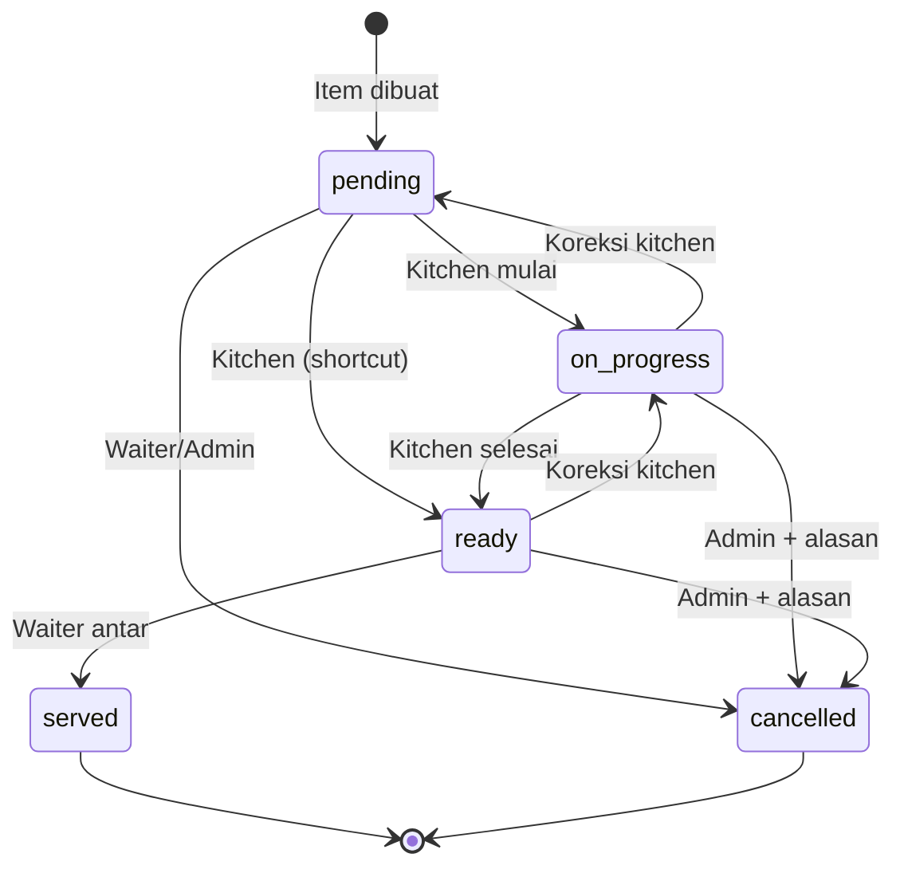
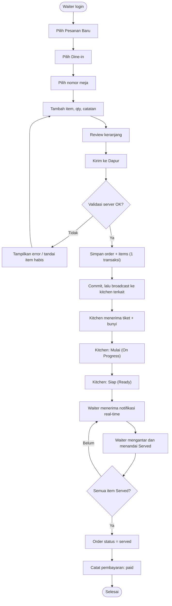
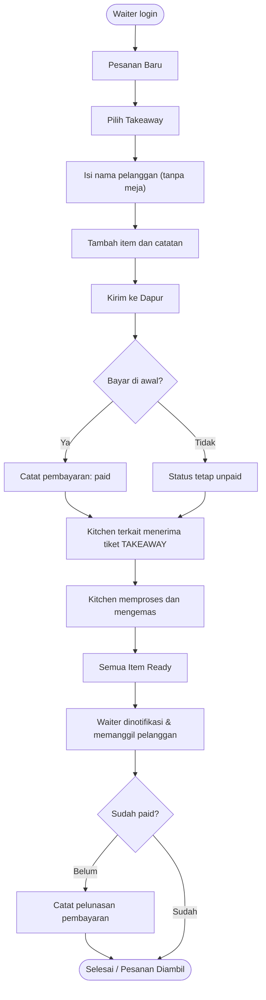
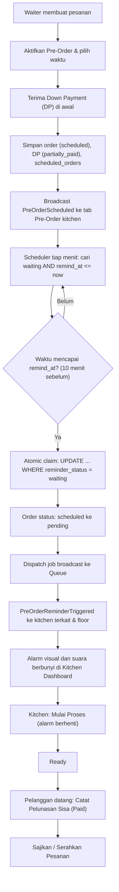
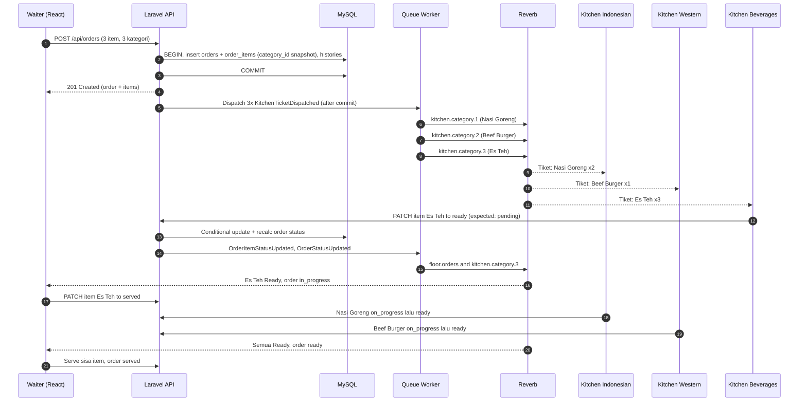
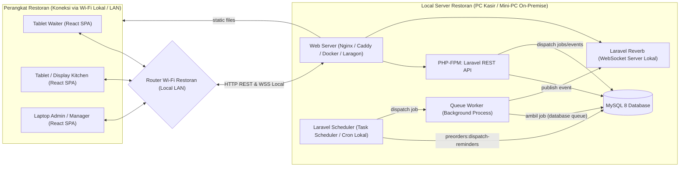
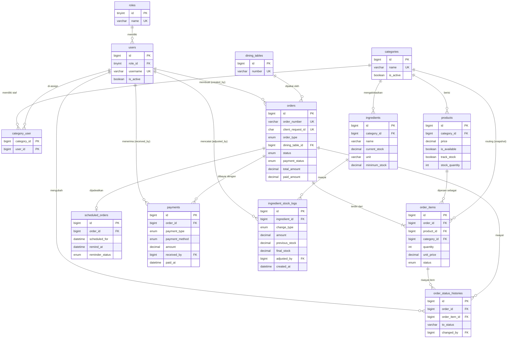
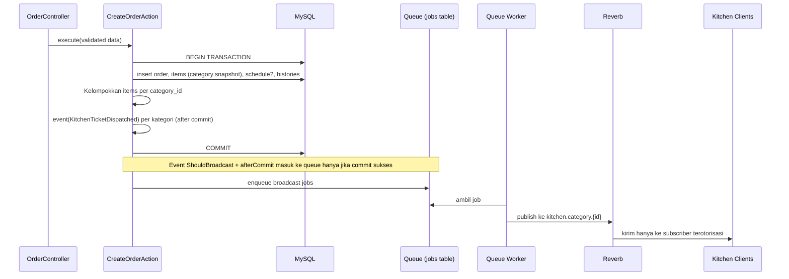
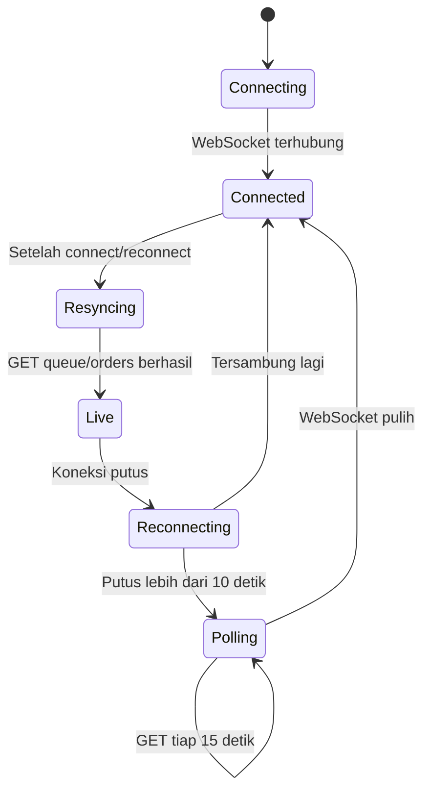
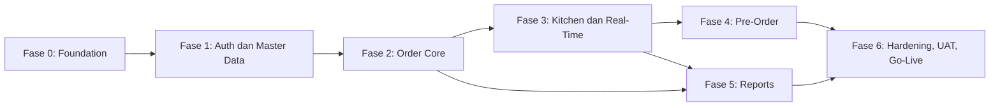

# Product Requirements Document (PRD)
# Servora — Restaurant Order & Kitchen Management System

| Atribut | Keterangan |
|---|---|
| Nama Produk | Servora |
| Tipe Produk | Restaurant Order & Kitchen Management System |
| Platform | Web Application (desktop & tablet) |
| Versi Dokumen | 1.0 (Draft untuk review) |
| Tanggal | 5 November 2026 |
| Status | Siap direview sebelum UI/UX design & development |
| Cakupan MVP | Single restaurant, multiple kitchen departments |

> **Konvensi dokumen**
> - `FR-xxx` = Functional Requirement, `NFR-xxx` = Non-Functional Requirement, `US-xxx` = User Story, `TC-xxx` = Test Case, `A-xx` = Asumsi, `Q-xx` = Open Question, `ADR-xx` = Architecture Decision Record.
> - Kata **WAJIB** (MUST), **SEBAIKNYA** (SHOULD), dan **BOLEH** (MAY) digunakan untuk menunjukkan tingkat keharusan.
> - Istilah **Kitchen Department** dan **Category** pada MVP merujuk ke entitas yang sama (lihat ADR-03).

---

## Daftar Isi

1. [Executive Summary](#1-executive-summary)
2. [Product Overview](#2-product-overview)
3. [Problem Statement](#3-problem-statement)
4. [Product Goals and Success Metrics](#4-product-goals-and-success-metrics)
5. [Target Users and Personas](#5-target-users-and-personas)
6. [User Roles and Permissions](#6-user-roles-and-permissions)
7. [Functional Requirements](#7-functional-requirements)
8. [User Stories](#8-user-stories)
9. [User Workflows](#9-user-workflows)
10. [System Architecture](#10-system-architecture)
11. [Database Schema and Relationships](#11-database-schema-and-relationships)
12. [REST API Specification](#12-rest-api-specification)
13. [Real-Time Communication Architecture](#13-real-time-communication-architecture)
14. [UI/UX Requirements](#14-uiux-requirements)
15. [Non-Functional Requirements](#15-non-functional-requirements)
16. [MVP Scope](#16-mvp-scope)
17. [Development Roadmap](#17-development-roadmap)
18. [Testing and Acceptance Criteria](#18-testing-and-acceptance-criteria)
19. [Risks, Constraints, and Edge Cases](#19-risks-constraints-and-edge-cases)
20. [Assumptions and Open Questions](#20-assumptions-and-open-questions)

---

## 1. Executive Summary

**Servora** adalah aplikasi web yang memusatkan alur pesanan restoran dari **waiter** ke **kitchen department** secara digital dan real-time. Waiter membuat pesanan (Dine-in / Takeaway / Pre-Order terjadwal) melalui tablet atau desktop; sistem secara otomatis **memecah item pesanan berdasarkan kategori makanan** dan mengirimkan setiap bagian hanya ke kitchen department yang bertanggung jawab. Kitchen staff memperbarui status per item (Pending → On Progress → Ready), dan waiter langsung melihat perubahan tersebut tanpa refresh halaman. Admin/Manager mengelola master data (user, kategori, produk, meja) dan memantau laporan penjualan.

**Nilai utama:**

1. **Menghilangkan miskomunikasi** — pesanan tercatat terstruktur (produk, jumlah, catatan khusus), bukan lisan/kertas.
2. **Routing otomatis per kitchen department** — setiap dapur hanya melihat item yang menjadi tanggung jawabnya, dengan otorisasi ketat di level API dan WebSocket channel.
3. **Visibilitas progres real-time** — status per item dan status keseluruhan pesanan terlihat oleh waiter dan admin.
4. **Pre-Order yang andal** — pengingat (alarm) otomatis ke dapur terkait pada waktu yang ditentukan, tanpa duplikasi, dan tetap berjalan setelah server restart.
5. **Laporan penjualan yang akurat** — dihitung hanya dari transaksi yang berstatus **paid**.

**Tech stack inti:** React.js + Tailwind CSS + Axios (frontend), Laravel REST API + Sanctum (backend), MySQL (database), Laravel Reverb + Broadcasting (real-time), Laravel Scheduler + Queue (background processing), Recharts (visualisasi), Local Server On-Premise / Local Wi-Fi Network (deployment mandiri di PC/mini-PC lokal tanpa biaya hosting).

Arsitektur sengaja dibuat sebagai **monolith modular** (satu aplikasi Laravel + satu SPA React) yang berjalan di server lokal restoran (PC Kasir / Local Server) dan diakses oleh tablet/desktop melalui router Wi-Fi lokal (LAN/WLAN) — tanpa biaya sewa VPS dan kebal pemadaman internet luar.

---

## 2. Product Overview

### 2.1 Visi Produk

Menjadi "sistem saraf" operasional restoran yang menghubungkan area layanan (floor) dan dapur secara instan, akurat, dan dapat dilacak.

### 2.2 Ringkasan Solusi

| Komponen | Deskripsi |
|---|---|
| Waiter Dashboard | Membuat pesanan, memilih produk per kategori, keranjang, Dine-in/Takeaway, nomor meja, Pre-Order, monitoring status, riwayat pesanan, mencatat pembayaran. |
| Kitchen Dashboard (Kitchen Display) | Antrean item khusus kategori dapur tersebut, notifikasi real-time + suara, kontrol status, tab Pre-Order dan alarm pengingat, toggle ketersediaan produk. |
| Admin Dashboard | Statistik operasional, manajemen user/role, kategori, produk, meja, monitoring semua pesanan, laporan penjualan. |
| Backend API | Laravel REST API, otorisasi berbasis role & kategori, order routing, kalkulasi status, scheduler pre-order. |
| Real-time Layer | Laravel Reverb (WebSocket server) dengan private channel per kitchen category dan channel floor untuk waiter/admin. |

### 2.3 In Scope (MVP)

- Autentikasi & RBAC (Admin, Waiter, Kitchen).
- Master data: user, kategori (kitchen department), produk, meja.
- Pembuatan pesanan Dine-in, Takeaway, dan Pre-Order; penambahan item ke pesanan aktif.
- Routing item ke kitchen department berdasarkan kategori produk.
- Status per item dan status agregat pesanan; riwayat perubahan status (audit trail).
- Notifikasi real-time ke kitchen dan waiter.
- Pre-Order scheduler dengan alarm + suara, pencegahan duplikasi, tahan terhadap restart.
- Pencatatan pembayaran sederhana (manual: tunai/QRIS/kartu — tanpa payment gateway).
- Laporan penjualan harian/mingguan/bulanan, produk terlaris, penjualan per kategori, riwayat pesanan (default 3 hari) & ekspor CSV.
- **Monitoring Stok Porsi Menu Jadi:** Pengurangan otomatis stok porsi saat pesanan dibuat, otomatis menjadi *Sold Out* jika stok habis (0), dan pengembalian stok jika item dibatalkan.
- **Monitoring Stok Bahan Baku (Raw Ingredients):** Pencatatan dan monitoring sisa bahan mentah (misal: daging sapi, tortilla, beras, sirup) dengan satuan ukur, peringatan stok menipis, dan log penyesuaian stok manual (tanpa sistem resep otomatis).

### 2.4 Out of Scope (MVP)

- Multi-outlet / multi-tenant.
- Integrasi payment gateway, cetak struk, printer dapur (thermal printer).
- Self-ordering oleh customer (QR menu), reservasi meja, loyalty program.
- **Sistem resep otomatis / Bill of Materials (BOM):** Pemotongan otomatis bahan mentah per gram/ml berdasarkan komposisi resep saat menu dipesan (dikelola secara mandiri di modul monitoring bahan baku).
- Pajak, service charge, diskon, dan promo (lihat Q-04).
- Aplikasi mobile native.

---

## 3. Problem Statement

### 3.1 Kondisi Saat Ini

Waiter mencatat pesanan di kertas lalu menyampaikannya secara lisan atau menyerahkan kertas ke dapur. Restoran memiliki beberapa tim dapur (yaitu Indonesian Food, Western Food, Beverages), sehingga satu pesanan pelanggan sering harus disampaikan ke beberapa tim berbeda.

### 3.2 Masalah, Dampak, dan Solusi

| # | Masalah | Dampak Operasional | Solusi Servora |
|---|---|---|---|
| P1 | Pesanan disampaikan lisan/tulisan tangan | Salah menu, salah jumlah, catatan khusus (mis. "tidak pedas") hilang | Pesanan digital terstruktur dengan `special_instructions` per item |
| P2 | Satu pesanan berisi item dari banyak dapur | Waiter harus mendatangi beberapa dapur; item terlewat | Routing otomatis item ke kitchen department berdasarkan kategori |
| P3 | Tidak ada visibilitas progres | Waiter bolak-balik menanyakan status ke dapur; pelanggan menunggu tanpa kepastian | Status per item real-time di dashboard waiter |
| P4 | Pesanan terjadwal (pre-order) bergantung pada ingatan | Pre-order terlambat atau terlupa | Scheduler + alarm visual & suara di dapur terkait |
| P5 | Rekap penjualan manual | Laporan lambat, rawan selisih | Laporan otomatis berbasis transaksi berstatus paid |
| P6 | Tidak ada jejak audit | Sulit menelusuri siapa membatalkan/mengubah pesanan | `order_status_histories` mencatat setiap perubahan status |

---

## 4. Product Goals and Success Metrics

### 4.1 Product Goals

| ID | Goal |
|---|---|
| G1 | Mengurangi kesalahan pesanan akibat miskomunikasi waiter–dapur. |
| G2 | Mempercepat waktu dari pesanan dibuat hingga diterima dapur menjadi hampir instan. |
| G3 | Memberikan visibilitas progres pesanan secara real-time ke waiter dan admin. |
| G4 | Memastikan tidak ada pre-order yang terlewat. |
| G5 | Menyediakan laporan penjualan yang akurat dan dapat difilter. |

### 4.2 Success Metrics

| Metric | Cara Mengukur | Target (3 bulan setelah go-live) |
|---|---|---|
| Order-to-kitchen latency | Selisih `orders.created_at` dengan waktu event diterima client kitchen (diukur saat UAT/monitoring) | p95 ≤ 2 detik |
| Order error rate | Jumlah item dibatalkan dengan alasan "salah input/salah pesanan" ÷ total item | Turun ≥ 50% dibanding baseline manual (baseline diukur 2 minggu sebelum go-live) |
| Pre-order on-time reminder | Reminder terkirim ≤ 60 detik setelah `remind_at` | ≥ 99% |
| Duplicate reminder | Jumlah reminder terkirim > 1 kali untuk pre-order yang sama | 0 |
| Wrong-routing incident | Item tampil di kitchen department yang salah | 0 |
| Rata-rata waktu persiapan | `ready_at − created_at` per item, per kategori | Terukur & tersedia di dashboard (baseline untuk perbaikan) |
| Adopsi | % pesanan yang dibuat via Servora | ≥ 95% setelah minggu ke-2 |
| Akurasi laporan | Selisih total laporan vs rekap kas harian | 0 selisih pada sampel UAT |

---

## 5. Target Users and Personas

### Persona 1 — Rina, Waiter

| Atribut | Detail |
|---|---|
| Usia / Pengalaman | 23 tahun, 2 tahun sebagai waiter |
| Perangkat | Tablet 10" milik restoran, kadang smartphone |
| Kebutuhan | Input pesanan cepat (< 1 menit), tahu kapan makanan siap, tidak perlu bolak-balik ke dapur |
| Pain point | Catatan khusus pelanggan sering terlupa; susah melacak pesanan meja mana yang sudah lengkap |
| Ekspektasi | UI sederhana, tombol besar, sedikit langkah, notifikasi saat item siap |

### Persona 2 — Pak Budi, Kitchen Staff (Indonesian Food)

| Atribut | Detail |
|---|---|
| Usia / Pengalaman | 38 tahun, juru masak senior |
| Perangkat | Tablet/monitor yang dipasang di area dapur, sering diakses dengan tangan basah/berminyak |
| Kebutuhan | Melihat hanya pesanan untuk stasiunnya, urutan antrean jelas, catatan khusus terlihat mencolok |
| Pain point | Kertas pesanan basah/hilang; pre-order terlupa |
| Ekspektasi | Teks besar, kontras tinggi, satu tap untuk mengubah status, alarm suara yang terdengar di dapur bising |

### Persona 3 — Ibu Sari, Restaurant Manager (Admin)

| Atribut | Detail |
|---|---|
| Usia / Pengalaman | 40 tahun, manajer operasional |
| Perangkat | Laptop/desktop |
| Kebutuhan | Kelola menu & harga, kelola akun staf, lihat penjualan harian/bulanan, produk terlaris |
| Pain point | Rekap manual memakan waktu, tidak tahu dapur mana yang menjadi bottleneck |
| Ekspektasi | Dashboard ringkas, filter tanggal, data akurat |

---

## 6. User Roles and Permissions

### 6.1 Definisi Role

| Role | Kode | Tanggung Jawab | Batas Akses |
|---|---|---|---|
| Admin / Manager | `admin` | Mengelola user & role, kategori, produk, harga, ketersediaan, meja; memonitor semua pesanan; akses laporan & statistik; melakukan tindakan override (mis. membatalkan item yang sudah diproses). | Akses penuh ke semua modul. Tidak dapat menonaktifkan/menghapus akunnya sendiri atau admin aktif terakhir. |
| Waiter (merangkap Kasir) | `waiter` | Membuat pesanan, menambah item, memilih Dine-in/Takeaway, nomor meja, Pre-Order, memonitor status, menandai item **Served** (khusus Dine-in), mengelola pembayaran (DP Pre-Order dan pelunasan), melihat riwayat pesanan. Karena skala UMKM, 1 orang waiter aktif merangkap sebagai kasir. | Tidak dapat mengakses manajemen master data, laporan penjualan, dan antrean kitchen. Hanya dapat membatalkan item berstatus Pending. |
| Kitchen Staff | `kitchen` | Menerima & memproses item untuk kategori yang di-assign, mengubah status item (On Progress, Ready), melihat Pre-Order kategori tersebut, menandai produk kategorinya habis (sold out). | **Hanya** item/order/channel dari kategori yang di-assign melalui tabel `category_user`. Tidak dapat melihat harga total, pembayaran, atau laporan. |

> Seorang kitchen staff **BOLEH** di-assign ke lebih dari satu kategori (mis. satu orang memegang Western Food dan Beverages). Lihat A-03.

### 6.2 Permission Matrix

Legenda: ✅ = diizinkan, ⚠️ = diizinkan dengan batasan, ❌ = tidak diizinkan.

| Permission | Admin | Waiter | Kitchen |
|---|---|---|---|
| Login / logout / lihat profil sendiri | ✅ | ✅ | ✅ |
| Kelola user (CRUD, aktif/nonaktif, reset password) | ✅ | ❌ | ❌ |
| Assign kategori ke kitchen staff | ✅ | ❌ | ❌ |
| CRUD kategori | ✅ | ❌ | ❌ |
| CRUD produk & harga | ✅ | ❌ | ❌ |
| Ubah ketersediaan produk (available / sold out) | ✅ | ❌ | ⚠️ hanya produk di kategorinya |
| CRUD meja | ✅ | ❌ | ❌ |
| Lihat daftar produk & kategori aktif | ✅ | ✅ | ⚠️ kategorinya saja |
| Membuat pesanan / menambah item | ⚠️ (opsional, A-07) | ✅ | ❌ |
| Melihat semua pesanan aktif (floor) | ✅ | ✅ | ❌ |
| Melihat antrean kitchen | ✅ (semua kategori, read-only) | ❌ | ⚠️ kategorinya saja |
| Ubah status item: Pending → On Progress → Ready | ⚠️ override | ❌ | ⚠️ kategorinya saja |
| Ubah status item: Ready → Served | ✅ | ✅ | ❌ |
| Batalkan item berstatus Pending | ✅ | ✅ | ❌ |
| Batalkan item berstatus On Progress / Ready | ✅ (wajib alasan) | ❌ | ❌ |
| Reschedule / batalkan Pre-Order (sebelum reminder) | ✅ | ✅ | ❌ |
| Catat pembayaran | ✅ | ✅ | ❌ |
| Kelola stok porsi produk (tambah/update stok porsi) | ✅ | ❌ | ⚠️ hanya produk di kategorinya |
| CRUD master bahan baku (ingredients) | ✅ | ❌ | ❌ |
| Monitoring & penyesuaian stok bahan baku (adjust stock) | ✅ | ❌ | ⚠️ hanya bahan baku di kategorinya |
| Lihat laporan penjualan | ✅ | ❌ | ❌ |
| Lihat statistik operasional | ✅ | ❌ | ❌ |

### 6.3 Penegakan Otorisasi

Otorisasi **WAJIB** ditegakkan di sisi server, bukan hanya dengan menyembunyikan elemen UI:

1. **Route middleware** `auth:sanctum` + middleware role (mis. `role:admin`).
2. **Laravel Policies/Gates** untuk otorisasi berbasis resource, contoh `OrderItemPolicy@updateKitchenStatus` memeriksa `order_item.category_id ∈ user.assignedCategoryIds`.
3. **Query scoping** — endpoint kitchen selalu memfilter `WHERE category_id IN (assigned categories)`; parameter `category_id` dari client hanya mempersempit, tidak pernah memperluas.
4. **Channel authorization** di `routes/channels.php` untuk private channel Reverb (lihat Bagian 13).

---

## 7. Functional Requirements

### 7.1 Modul A — Authentication & User Management

| ID | Requirement | Prioritas |
|---|---|---|
| FR-AUTH-01 | Sistem WAJIB menyediakan login menggunakan `username` dan `password`. (Email opsional karena tidak semua staf memiliki email — A-02.) | Must |
| FR-AUTH-02 | Sistem WAJIB menolak login untuk user dengan `is_active = false` dengan pesan yang jelas. | Must |
| FR-AUTH-03 | Setelah login, user WAJIB diarahkan ke dashboard sesuai role: Admin → `/admin`, Waiter → `/waiter`, Kitchen → `/kitchen`. | Must |
| FR-AUTH-04 | Sistem WAJIB menyediakan logout yang menginvalidasi session/token di server. | Must |
| FR-AUTH-05 | Login WAJIB dibatasi rate limit: maksimal 5 percobaan gagal per menit per kombinasi username + IP. | Must |
| FR-AUTH-06 | Password WAJIB di-hash (bcrypt/argon2 bawaan Laravel), minimal 8 karakter. | Must |
| FR-AUTH-07 | Session idle timeout SEBAIKNYA dapat dikonfigurasi (default 12 jam untuk menutupi satu shift; tablet dapur boleh tetap login selama shift). | Should |
| FR-USR-01 | Admin WAJIB dapat membuat user dengan atribut: nama, username, email (opsional), password awal, role. | Must |
| FR-USR-02 | Admin WAJIB dapat mengubah data user, mengganti role, dan me-reset password user. | Must |
| FR-USR-03 | Admin WAJIB dapat menonaktifkan/mengaktifkan user. User nonaktif tidak dapat login dan session/token aktifnya dicabut. | Must |
| FR-USR-04 | Penghapusan user WAJIB menggunakan **soft delete** agar riwayat pesanan (`created_by`, `changed_by`) tetap utuh. | Must |
| FR-USR-05 | Admin WAJIB dapat meng-assign satu atau lebih kategori ke user ber-role `kitchen`. User kitchen tanpa kategori tidak melihat antrean apa pun dan diberi pesan "Belum di-assign ke kitchen department". | Must |
| FR-USR-06 | Sistem WAJIB mencegah admin menonaktifkan/menghapus dirinya sendiri dan mencegah hilangnya admin aktif terakhir. | Must |
| FR-USR-07 | User dapat mengganti password-nya sendiri. | Should |

### 7.2 Modul B — Category (Kitchen Department) & Product Management

| ID | Requirement | Prioritas |
|---|---|---|
| FR-CAT-01 | Admin WAJIB dapat membuat, mengubah, dan menghapus kategori. Atribut: nama (unik), deskripsi, urutan tampil (`sort_order`), status aktif. | Must |
| FR-CAT-02 | Setiap kategori WAJIB merepresentasikan satu **kitchen department** yang menjadi tujuan routing item (ADR-03). | Must |
| FR-CAT-03 | Kategori yang masih memiliki produk aktif atau item pesanan aktif (Pending/On Progress/Ready) TIDAK BOLEH dihapus; admin harus memindahkan produk atau menonaktifkan kategori terlebih dahulu. | Must |
| FR-CAT-04 | Penghapusan kategori menggunakan soft delete; kategori yang dihapus tetap muncul di laporan historis. | Must |
| FR-CAT-05 | Kategori default yang di-seed (3 kategori): `Indonesian Food`, `Western Food`, `Beverages`. Tipe kategori pada menu waiter dan kitchen department identik 1:1. | Must |
| FR-PRD-01 | Admin WAJIB dapat membuat, mengubah, dan menghapus produk. Atribut: nama, kategori (wajib, tepat satu), harga, deskripsi, gambar (opsional), status ketersediaan (`is_available`), status aktif (`is_active`), `sort_order`. | Must |
| FR-PRD-02 | Harga WAJIB berupa angka ≥ 0 dalam Rupiah dan sudah nett (inklusif pajak PB1 & service charge — A-06, Q-04). Perubahan harga TIDAK memengaruhi pesanan yang sudah dibuat (harga di-snapshot di `order_items.unit_price`). | Must |
| FR-PRD-03 | Pemindahan produk ke kategori lain hanya berlaku untuk item pesanan baru; item yang sudah dibuat tetap di-routing ke kategori saat pesanan dibuat (snapshot `order_items.category_id`). | Must |
| FR-PRD-04 | Produk dengan `is_available = false` WAJIB tetap tampil di menu waiter dengan label "Habis" dan tidak dapat ditambahkan ke keranjang. | Must |
| FR-PRD-05 | Kitchen staff WAJIB dapat mengubah `is_available` produk dalam kategori yang di-assign kepadanya (menandai sold out saat bahan habis). | Must |
| FR-PRD-06 | Perubahan ketersediaan produk WAJIB di-broadcast real-time ke waiter (event `ProductAvailabilityUpdated`). | Must |
| FR-PRD-07 | Produk yang pernah dipesan dihapus dengan soft delete. Produk nonaktif (`is_active = false`) tidak tampil di menu waiter. | Must |
| FR-PRD-08 | Setiap produk WAJIB memiliki opsi pelacakan porsi (`track_stock`: boolean) dan kuantitas porsi (`stock_quantity`: integer). Jika `track_stock = false`, porsi dianggap tak terbatas dan ketersediaan dikontrol manual via `is_available`. | Must |
| FR-PRD-09 | Admin dan Kitchen staff (kategori terkait) WAJIB dapat memperbarui jumlah porsi `stock_quantity` secara instan dari dashboard. | Must |
| FR-TBL-01 | Admin WAJIB dapat mengelola daftar meja: nomor meja (unik), kapasitas, area (opsional), status aktif. | Must |
| FR-TBL-02 | Waiter memilih meja dari daftar meja aktif (bukan input teks bebas) untuk mencegah salah ketik. | Must |

### 7.3 Modul C — Order Management

| ID | Requirement | Prioritas |
|---|---|---|
| FR-ORD-01 | Waiter WAJIB dapat membuat pesanan yang berisi satu atau lebih item. | Must |
| FR-ORD-02 | Setiap item WAJIB memiliki: produk, nama produk (snapshot), kuantitas (1–99), harga satuan (snapshot), subtotal, dan catatan khusus opsional (maks. 255 karakter). | Must |
| FR-ORD-03 | Pesanan WAJIB memiliki tipe `dine_in` atau `takeaway`. | Must |
| FR-ORD-04 | Pesanan `dine_in` WAJIB memiliki `dining_table_id` yang valid dan aktif. | Must |
| FR-ORD-05 | Pesanan `takeaway` TIDAK BOLEH mewajibkan meja (`dining_table_id = null`); field `customer_name` SEBAIKNYA diisi untuk memudahkan pemanggilan pelanggan. | Must |
| FR-ORD-06 | Setiap pesanan WAJIB memiliki nomor unik dengan format `SRV-YYYYMMDD-NNNN` (nomor urut harian, reset setiap hari, mis. `SRV-20261105-0042`). Keunikan dijamin oleh unique index di database. | Must |
| FR-ORD-07 | Produk yang sama dengan catatan khusus berbeda WAJIB disimpan sebagai baris item terpisah (mis. 1× Nasi Goreng "pedas" dan 1× Nasi Goreng "tidak pedas"). Produk yang sama dengan catatan yang sama digabung menjadi satu baris dengan kuantitas dijumlahkan di sisi keranjang. | Must |
| FR-ORD-08 | Saat submit, server WAJIB memvalidasi ulang: produk aktif & tersedia, kategori aktif, meja aktif (untuk dine-in), kuantitas valid, dan mencukupi stok jika `track_stock = true`. Jika stok porsi kurang dari kuantitas yang dipesan, server WAJIB menolak dengan HTTP 422 (`INSUFFICIENT_STOCK`) beserta info sisa stok. Harga diambil dari database, **bukan** dari request client. | Must |
| FR-ORD-09 | Jika ada produk yang tidak tersedia saat submit, server WAJIB menolak seluruh pesanan (HTTP 422) dan mengembalikan daftar `product_id` yang bermasalah sehingga UI dapat menandainya di keranjang. Tidak ada pesanan parsial. | Must |
| FR-ORD-10 | Pembuatan pesanan WAJIB atomik: penyimpanan `orders`, `order_items`, `scheduled_orders` (jika pre-order), `order_status_histories`, dan **pemotongan stok porsi** (`stock_quantity -= quantity` untuk produk yang dilacak stoknya) dilakukan dalam satu database transaction. Jika `stock_quantity` habis (menjadi 0), produk otomatis ditandai `is_available = false` dan mem-broadcast `ProductAvailabilityUpdated`. Event broadcast hanya dikirim **setelah commit**. | Must |
| FR-ORD-11 | Request pembuatan pesanan WAJIB membawa `client_request_id` (UUID yang dibuat client per sesi checkout). Jika request dengan `client_request_id` yang sama dikirim ulang, server WAJIB mengembalikan pesanan yang sudah ada (HTTP 200) alih-alih membuat duplikat (idempotency). | Must |
| FR-ORD-12 | **Category-based routing:** setiap `order_item` WAJIB menyimpan `category_id` (snapshot dari kategori produk saat pesanan dibuat). Kitchen department hanya menerima dan menampilkan item dengan `category_id` yang di-assign kepadanya, sementara semua item tetap terhubung ke `order_id` yang sama. | Must |
| FR-ORD-13 | Setelah commit, sistem WAJIB mengelompokkan item per `category_id` dan mem-broadcast satu event `KitchenTicketDispatched` per kategori, berisi **hanya** item kategori tersebut (lihat 7.4). | Must |
| FR-ORD-14 | Waiter WAJIB dapat menambahkan item baru ke pesanan yang masih aktif (status bukan `served`/`cancelled` dan `payment_status = unpaid`). Item tambahan di-routing dan di-broadcast dengan mekanisme yang sama (FR-ORD-12, FR-ORD-13), dengan penanda "Tambahan" di kitchen. | Must |
| FR-ORD-15 | Item yang sudah disubmit tidak dapat diedit (produk/kuantitas). Koreksi dilakukan dengan membatalkan item Pending lalu menambah item baru. | Must |
| FR-ORD-16 | Waiter WAJIB dapat membatalkan item berstatus `pending`. Pembatalan item berstatus `on_progress`/`ready` hanya oleh Admin dengan alasan wajib. Jika item yang dibatalkan memiliki `track_stock = true`, sistem WAJIB mengembalikan stok porsi secara otomatis (`stock_quantity += quantity`) dan memulihkan status ketersediaan jika sebelumnya sold out. Pembatalan di-broadcast ke kitchen terkait. | Must |
| FR-ORD-17 | Waiter WAJIB dapat membatalkan seluruh pesanan jika semua item aktif masih `pending`. Jika ada item yang sudah diproses, pembatalan memerlukan Admin (lihat 19.2, R-08). | Must |
| FR-ORD-18 | `orders.total_amount` WAJIB dihitung server sebagai jumlah `subtotal` item yang tidak dibatalkan, dan dihitung ulang setiap ada penambahan/pembatalan item, dalam transaksi yang sama. | Must |
| FR-ORD-19 | Waiter/Admin (merangkap Kasir) WAJIB dapat mencatat pembayaran ke tabel `payments`: metode (`cash`, `qris`, `debit_card`, `credit_card`, `other`) dan tipe (`full`, `down_payment`, `settlement`). Pembayaran uang muka (DP) mengubah `payment_status` menjadi `partially_paid`, dan pelunasan mengubahnya menjadi `paid`. Pesanan yang sudah `paid` tidak dapat ditambah item atau dibatalkan (A-05, Q-03). | Must |
| FR-ORD-20 | Waiter WAJIB dapat melihat daftar pesanan aktif (filter: milik saya / semua, tipe, meja, status) dan riwayat pesanan (filter tanggal). | Must |
| FR-ORD-21 | Setiap pesanan menampilkan detail: nomor, tipe, meja/nama pelanggan, waiter pembuat, waktu dibuat, jadwal (jika pre-order), item per kategori beserta status, total, status pembayaran, dan timeline status. | Must |

### 7.4 Modul D — Real-Time Kitchen Notification System

| ID | Requirement | Prioritas |
|---|---|---|
| FR-RTN-01 | Sistem WAJIB menggunakan Laravel Broadcasting dengan driver **Laravel Reverb** sebagai WebSocket server dan **Laravel Echo** di frontend. | Must |
| FR-RTN-02 | Setiap kitchen department WAJIB memiliki private channel tersendiri: `kitchen.category.{categoryId}`. | Must |
| FR-RTN-03 | Otorisasi channel kitchen WAJIB memastikan hanya user role `kitchen` yang di-assign ke kategori tersebut (atau `admin`) yang dapat subscribe. | Must |
| FR-RTN-04 | Ketika pesanan reguler (non pre-order) dibuat, setiap kitchen department terkait WAJIB menerima event `KitchenTicketDispatched` yang hanya memuat item kategorinya. | Must |
| FR-RTN-05 | Kitchen dashboard WAJIB menambahkan tiket baru ke antrean tanpa refresh halaman, disertai indikator visual (highlight) dan bunyi notifikasi singkat. | Must |
| FR-RTN-06 | Ketika kitchen mengubah status item, waiter dan admin WAJIB menerima event `OrderItemStatusUpdated` dan `OrderStatusUpdated` (jika status agregat berubah) melalui channel `floor.orders`. | Must |
| FR-RTN-07 | Kitchen staff lain dalam kategori yang sama WAJIB melihat perubahan status item secara real-time (untuk mencegah dua orang memasak item yang sama). | Must |
| FR-RTN-08 | Waiter WAJIB mendapat notifikasi menonjol (toast + bunyi opsional) ketika item pesanan **yang ia buat** menjadi Ready. | Must |
| FR-RTN-09 | **Database adalah source of truth.** Event broadcast berfungsi sebagai pemicu pembaruan UI. Setelah koneksi WebSocket tersambung kembali, client WAJIB melakukan re-sync data via REST API. | Must |
| FR-RTN-10 | Client WAJIB menampilkan indikator status koneksi real-time (Terhubung / Menyambung ulang / Terputus). Saat terputus > 10 detik, client WAJIB fallback ke polling REST setiap 15 detik sampai koneksi pulih. | Must |
| FR-RTN-11 | Setiap event WAJIB memiliki `event_id` (UUID) dan `occurred_at` agar client dapat mengabaikan event duplikat atau event yang lebih lama dari state lokal. | Must |

### 7.5 Modul E — Order Status Management

#### 7.5.1 Status Item (`order_items.status`)

| Status | Kode | Arti | Diubah oleh |
|---|---|---|---|
| Pending | `pending` | Item diterima, belum mulai diproses dapur | Sistem (saat dibuat) |
| On Progress | `on_progress` | Dapur sedang menyiapkan item | Kitchen (kategori terkait) |
| Ready | `ready` | Item siap diambil/diantar | Kitchen (kategori terkait) |
| Served | `served` | Item sudah diantar ke meja / diserahkan ke pelanggan takeaway | Waiter / Admin |
| Cancelled | `cancelled` | Item dibatalkan | Waiter (hanya dari Pending) / Admin |

#### 7.5.2 Transisi Status Item yang Diizinkan

| Dari | Ke | Aktor | Catatan |
|---|---|---|---|
| `pending` | `on_progress` | Kitchen | Normal flow |
| `pending` | `ready` | Kitchen | Shortcut untuk item instan (mis. minuman kemasan) agar mengurangi jumlah tap |
| `on_progress` | `ready` | Kitchen | Normal flow |
| `on_progress` | `pending` | Kitchen | Koreksi (salah tap); tercatat di history |
| `ready` | `on_progress` | Kitchen | Koreksi sebelum disajikan; tercatat di history |
| `ready` | `served` | Waiter / Admin | Normal flow |
| `pending` | `cancelled` | Waiter / Admin | — |
| `on_progress`, `ready` | `cancelled` | Admin | Alasan wajib |
| `served`, `cancelled` | (apa pun) | — | **Status final**, tidak dapat diubah |



| ID | Requirement | Prioritas |
|---|---|---|
| FR-STS-01 | Server WAJIB menolak transisi status yang tidak ada di tabel 7.5.2 dengan HTTP 422. | Must |
| FR-STS-02 | Update status WAJIB menggunakan **conditional update** (optimistic concurrency): request membawa `expected_status`; server mengeksekusi update hanya jika status saat ini sama dengan `expected_status`. Jika tidak cocok, server mengembalikan HTTP 409 beserta state terbaru. | Must |
| FR-STS-03 | Setiap perubahan status item dan status order WAJIB dicatat di `order_status_histories` (dari, ke, oleh siapa, kapan, catatan). | Must |
| FR-STS-04 | Timestamp `started_at`, `ready_at`, `served_at`, `cancelled_at` pada item WAJIB diisi saat transisi terkait (untuk metrik waktu persiapan). | Must |
| FR-STS-05 | Kitchen WAJIB dapat mengubah status seluruh item kategorinya dalam satu pesanan sekaligus (bulk action "Mulai Semua" / "Siap Semua"). | Must |

#### 7.5.3 Status Pesanan (`orders.status`) — Order-Level

Status order adalah **status agregat** yang **diturunkan (derived)** dari status item, lalu disimpan (cached) di kolom `orders.status` untuk kebutuhan query, filter, dan broadcast. Nilainya dihitung ulang oleh server dalam transaksi yang sama setiap kali status item berubah, item ditambah, atau item dibatalkan. Client **tidak pernah** mengirim status order secara langsung (kecuali aksi pembatalan order yang diproses sebagai pembatalan seluruh item).

| Status | Kode | Arti |
|---|---|---|
| Scheduled | `scheduled` | Pre-order yang reminder-nya belum terpicu dan belum ada item yang mulai diproses |
| Pending | `pending` | Semua item aktif masih Pending |
| In Progress | `in_progress` | Minimal satu item aktif sudah mulai diproses, tetapi belum semua item aktif Ready/Served |
| Ready | `ready` | Semua item aktif berstatus Ready atau Served, dan minimal satu masih Ready (belum semua disajikan) |
| Served | `served` | Semua item aktif berstatus Served |
| Cancelled | `cancelled` | Semua item berstatus Cancelled |

> **Item aktif** = item dengan status selain `cancelled`.  
> **Catatan khusus Takeaway (Q-08):** Untuk pesanan `takeaway`, status item dan order cukup sampai **Ready** (siap diambil pelanggan). Ketika semua item berstatus `ready` dan pembayaran `paid`, pesanan takeaway dianggap tuntas tanpa memerlukan aksi klik `served` manual. Status **Served** dikhususkan untuk pesanan `dine_in` saat waiter menyajikan makanan ke meja.

**Aturan kalkulasi (dievaluasi berurutan, aturan pertama yang cocok digunakan):**

| Urutan | Kondisi | Status Order |
|---|---|---|
| 1 | Tidak ada item aktif (semua `cancelled`) | `cancelled` |
| 2 | Semua item aktif = `served` | `served` |
| 3 | Semua item aktif ∈ {`ready`, `served`} | `ready` |
| 4 | Ada item aktif ∈ {`on_progress`, `ready`, `served`} | `in_progress` |
| 5 | Semua item aktif = `pending` **dan** pesanan adalah pre-order dengan `reminder_status = waiting` | `scheduled` |
| 6 | Semua item aktif = `pending` | `pending` |

**Contoh pesanan multi-kategori** (`SRV-20261105-0042`, Meja 7):

| Item | Kategori | Status Item |
|---|---|---|
| Nasi Goreng Spesial ×2 | Indonesian Food | `ready` |
| Beef Burger ×1 | Western Food | `on_progress` |
| Es Teh Manis ×3 | Beverages | `served` |

→ Status order = `in_progress` (aturan 4). UI waiter menampilkan progres **"Siap/Tersaji: 5 dari 6 porsi"** dan badge per kategori: Indonesian ✅ Ready, Western 🔄 On Progress, Beverages ✔️ Served.

| ID | Requirement | Prioritas |
|---|---|---|
| FR-STS-06 | Waiter WAJIB dapat menyajikan item secara parsial (menandai Served per item/per kategori) tanpa menunggu seluruh pesanan Ready, karena tiap kitchen department memiliki waktu persiapan berbeda. | Must |
| FR-STS-07 | UI waiter WAJIB menampilkan status per kategori dan status agregat order secara bersamaan. | Must |
| FR-STS-08 | `payment_status` (`unpaid`, `partially_paid`, `paid`) WAJIB terpisah dari `status` operasional. Pesanan bisa `served` tetapi `unpaid` (dine-in bayar di akhir), `partially_paid` (pre-order dengan DP), atau `paid` tetapi `pending` (takeaway bayar di awal). | Must |

### 7.6 Modul F — Pre-Order Scheduling & Alarm System

#### 7.6.1 Perbedaan Regular Order vs Pre-Order

| Aspek | Regular Order | Pre-Order (Scheduled) |
|---|---|---|
| Waktu pemenuhan | Secepatnya | Pada `scheduled_for` (waktu pelanggan ingin makanan siap/diambil) |
| Data tambahan | — | Baris di `scheduled_orders` (`scheduled_for`, `remind_at`, `reminder_status`) |
| Status awal order | `pending` | `scheduled` |
| Tampil di antrean aktif kitchen | Langsung | Setelah reminder terpicu (`remind_at`); sebelumnya tampil di tab "Pre-Order" |
| Notifikasi ke kitchen saat dibuat | `KitchenTicketDispatched` (bunyi + highlight) | `PreOrderScheduled` (tanpa alarm, hanya update tab Pre-Order) |
| Notifikasi saat waktunya | — | `PreOrderReminderTriggered` (alarm visual + suara berulang) |
| Tipe | Dine-in / Takeaway | Dine-in / Takeaway |

#### 7.6.2 Functional Requirements

| ID | Requirement | Prioritas |
|---|---|---|
| FR-PRE-01 | Waiter WAJIB dapat menandai pesanan sebagai Pre-Order dan mengisi `scheduled_for` (tanggal & jam). | Must |
| FR-PRE-02 | `scheduled_for` WAJIB minimal **30 menit** dari waktu saat ini dan maksimal **7 hari** ke depan (nilai dapat dikonfigurasi; A-08). | Must |
| FR-PRE-03 | Sistem WAJIB menghitung `remind_at = scheduled_for − preorder_lead_minutes` (default **10 menit** sebelum waktu pesanan, seragam untuk semua kategori — Q-06. Contoh: pesan jam 10:00 $\rightarrow$ alarm berbunyi jam 09:50). Jika hasilnya sudah lewat/terlalu dekat, `remind_at = now()`. | Must |
| FR-PRE-04 | Pre-order WAJIB disimpan di database (`scheduled_orders`) sehingga tetap terkelola saat server/worker restart. Tidak ada jadwal yang hanya disimpan di memori atau sebagai delayed job saja. | Must |
| FR-PRE-05 | Laravel Scheduler WAJIB menjalankan command `preorders:dispatch-reminders` **setiap menit**, yang mencari `scheduled_orders` dengan `reminder_status = 'waiting'` dan `remind_at <= now()`. | Must |
| FR-PRE-06 | **Pencegahan duplikasi:** untuk setiap kandidat, command WAJIB melakukan *atomic claim* dengan conditional update (`SET reminder_status='sent', reminder_sent_at=now() WHERE id=? AND reminder_status='waiting'`). Hanya jika affected rows = 1, job broadcast reminder di-dispatch ke queue. Scheduler WAJIB memakai `withoutOverlapping()`. | Must |
| FR-PRE-07 | Setelah reminder terpicu, status order berubah dari `scheduled` menjadi `pending` (aturan 7.5.3), item masuk antrean aktif kitchen, dan setiap kitchen department terkait menerima `PreOrderReminderTriggered` yang hanya memuat item kategorinya. Waiter pembuat juga menerima notifikasi. | Must |
| FR-PRE-08 | Kitchen dashboard WAJIB menampilkan alarm: banner/modal mencolok + bunyi berulang (setiap 10 detik) sampai salah satu staf kategori tersebut menekan "Mulai Proses" (item → `on_progress`) atau "Tandai Dilihat" (mematikan suara lokal di perangkat itu). | Must |
| FR-PRE-09 | Status alarm WAJIB dapat diturunkan dari data (pre-order dengan `reminder_status='sent'` yang item kategorinya masih `pending`), sehingga jika halaman kitchen di-refresh atau baru dibuka, alarm yang belum ditangani tetap muncul. | Must |
| FR-PRE-10 | **Pemulihan setelah downtime:** karena query memakai `remind_at <= now()`, reminder yang terlewat selama server mati akan otomatis terkirim pada eksekusi scheduler pertama setelah server hidup, dengan penanda **"Terlambat X menit"**. | Must |
| FR-PRE-11 | Waiter/Admin WAJIB dapat mengubah jadwal (reschedule) atau membatalkan pre-order selama `reminder_status = 'waiting'`. Reschedule menghitung ulang `remind_at`. | Must |
| FR-PRE-12 | Kitchen BOLEH mulai memproses item pre-order lebih awal dari tab Pre-Order (mis. persiapan lama). Jika semua item kategori lain juga sudah diproses, reminder tetap dikirim namun tanpa alarm untuk kategori yang item-nya sudah tidak pending. | Should |
| FR-PRE-13 | Tab Pre-Order di kitchen WAJIB menampilkan daftar pre-order mendatang untuk kategorinya, diurutkan berdasarkan `scheduled_for`, dengan countdown. | Must |
| FR-PRE-14 | Pre-Order WAJIB mencatat pembayaran uang muka (Down Payment / DP) di awal saat pesanan dibuat (Q-03). Transaksi DP dicatat di tabel `payments` (`payment_type = 'down_payment'`), menjadikan status pembayaran `partially_paid`. Pelunasan sisa tagihan dilakukan saat pesanan diambil. | Must |

### 7.7 Modul G — Sales Reporting Dashboard

#### 7.7.1 Definisi Transaksi Penjualan

> **Penjualan (sale)** dihitung berdasarkan total uang yang telah diterima dari transaksi di tabel `payments` (mencakup pembayaran lunas `full`, uang muka `down_payment`, dan pelunasan `settlement`). Pesanan yang belum dibayar (`unpaid`) atau dibatalkan (`cancelled`) tidak dihitung ke pendapatan. Tanggal transaksi yang digunakan adalah **`payments.paid_at`** (bukan `orders.created_at`). (A-05, A-06, Q-03, Q-04)

#### 7.7.2 Logika Kalkulasi

| Metrik | Formula | Sumber Data |
|---|---|---|
| Total Revenue | `SUM(orders.total_amount)` untuk order `paid` dengan `paid_at` dalam rentang | `orders` |
| Total Orders (penjualan) | `COUNT(orders.id)` untuk order `paid` dalam rentang | `orders` |
| Average Order Value | Total Revenue ÷ Total Orders | Turunan |
| Total item terjual | `SUM(order_items.quantity)` item non-`cancelled` dari order `paid` | `order_items` + `orders` |
| Best-selling products | `GROUP BY order_items.product_id` → `SUM(quantity)` dan `SUM(subtotal)`, item non-`cancelled`, order `paid`; diurutkan berdasarkan qty (default) atau revenue; nama dari snapshot `product_name` terbaru | `order_items` + `orders` |
| Sales by category | `GROUP BY order_items.category_id` → `SUM(subtotal)`, `SUM(quantity)`; memakai snapshot kategori saat transaksi | `order_items` + `orders` + `categories` |
| Sales trend | Revenue & jumlah order per hari/minggu/bulan | `orders` |
| Order operasional (non-sales) | Jumlah order dibuat, dibatalkan, belum dibayar per periode (berdasarkan `created_at`) | `orders` |
| Rata-rata waktu persiapan | `AVG(ready_at − created_at)` per kategori (item yang mencapai `ready`) | `order_items` |

#### 7.7.3 Periode & Filter

| ID | Requirement | Prioritas |
|---|---|---|
| FR-RPT-01 | Ringkasan **harian**: 00:00:00–23:59:59 waktu restoran (Asia/Jakarta) pada tanggal terpilih. | Must |
| FR-RPT-02 | Ringkasan **mingguan**: Senin 00:00 s.d. Minggu 23:59:59 (ISO week) yang memuat tanggal terpilih. | Must |
| FR-RPT-03 | Ringkasan **bulanan**: tanggal 1 s.d. akhir bulan terpilih. | Must |
| FR-RPT-04 | Laporan WAJIB mendukung rentang kustom (`from`, `to`, maks. 366 hari). | Must |
| FR-RPT-05 | Setiap ringkasan WAJIB menampilkan perbandingan dengan periode sebelumnya (mis. hari ini vs kemarin, dalam %). | Should |
| FR-RPT-06 | Laporan produk terlaris WAJIB menampilkan top N (default 10) dengan qty & revenue; dapat difilter per kategori. | Must |
| FR-RPT-07 | Laporan penjualan per kategori WAJIB ditampilkan dalam tabel dan grafik (Recharts: bar/pie). | Must |
| FR-RPT-08 | Riwayat pesanan WAJIB dapat difilter berdasarkan rentang tanggal, status order, status pembayaran, tipe order, waiter, dan dicari berdasarkan nomor order; dengan pagination. | Must |
| FR-RPT-09 | Ekspor laporan ke CSV. | Should |
| FR-RPT-10 | Semua angka laporan WAJIB dihitung di server (query agregasi SQL), bukan di client. | Must |

### 7.8 Modul H — Stock & Raw Material Inventory Management (Bahan Baku)

Modul ini mengelola dua lapisan stok: **Stok Porsi Menu Jadi** (otomatis berkurang saat dipesan) dan **Monitoring Bahan Baku Mentah** (pencatatan manual/semi-manual tanpa sistem resep otomatis).

#### 7.8.1 Stok Porsi Menu Jadi (Product Portion Stock)

| ID | Requirement | Prioritas |
|---|---|---|
| FR-STK-01 | Setiap produk dapat dikonfigurasi apakah dilacak stoknya (`track_stock = true`) atau tidak (`track_stock = false`). | Must |
| FR-STK-02 | Produk dengan `track_stock = true` WAJIB memiliki nilai `stock_quantity` (bilangan bulat ≥ 0). | Must |
| FR-STK-03 | Saat pesanan dibuat atau item ditambah, sistem WAJIB memeriksa apakah stok mencukupi. Jika kurang, transaksi ditolak (HTTP 422 `INSUFFICIENT_STOCK`). | Must |
| FR-STK-04 | Saat pesanan berhasil disimpan, sistem WAJIB memotong `stock_quantity` secara atomik di dalam database transaction. | Must |
| FR-STK-05 | Jika `stock_quantity` mencapai 0, sistem WAJIB otomatis mengubah status ketersediaan produk menjadi `is_available = false` dan mem-broadcast `ProductAvailabilityUpdated` ke seluruh klien waiter. | Must |
| FR-STK-06 | Jika item pesanan dibatalkan (oleh Waiter atau Admin), sistem WAJIB mengembalikan kuantitas stok yang dibatalkan secara otomatis (`stock_quantity += quantity`). | Must |
| FR-STK-07 | Admin dan Kitchen staff (kategori terkait) WAJIB dapat memperbarui jumlah porsi sisa kapan saja dari dashboard. | Must |

#### 7.8.2 Monitoring Bahan Baku (Raw Material / Ingredient Tracking)

| ID | Requirement | Prioritas |
|---|---|---|
| FR-ING-01 | Admin WAJIB dapat mengelola master data bahan baku (`ingredients`): nama bahan, stasiun/kategori dapur penanggung jawab (`category_id` nullable), stok saat ini (`current_stock`), satuan (`unit`: misal kg, gram, lembar, pcs, liter, botol, butir), ambang batas stok minimum (`minimum_stock`), dan catatan. | Must |
| FR-ING-02 | Admin dan Kitchen Staff (hanya bahan di kategorinya) WAJIB dapat melihat daftar stok bahan baku saat ini. | Must |
| FR-ING-03 | Sistem WAJIB menampilkan indikator/badge visual mencolok **"Stok Menipis"** jika `current_stock <= minimum_stock`. | Must |
| FR-ING-04 | Admin dan Kitchen Staff (kategori terkait) WAJIB dapat melakukan penyesuaian stok (*Quick Adjust Stock*): penambahan stok (restock/belanja), pengurangan stok (pemakaian dapur/rusak), atau penyesuaian opname langsung. | Must |
| FR-ING-05 | Setiap kali stok bahan baku disesuaikan, sistem WAJIB mencatat entri riwayat di `ingredient_stock_logs` mencakup jenis perubahan (`in`, `out`, `adjustment`), jumlah, stok sebelum & sesudah, user pengubah, dan alasan. | Must |
| FR-ING-06 | Sistem ini **TIDAK menerapkan formula resep otomatis / Bill of Materials (BOM)** saat menu dipesan (sesuai kesepakatan), melainkan berfungsi sebagai lembar kontrol bahan baku dapur yang mudah diupdate dan dipantau staf. | Must |

---

## 8. User Stories

| ID | Sebagai | Saya ingin | Sehingga | FR Terkait |
|---|---|---|---|---|
| US-01 | Staf | login dengan username & password | saya masuk ke dashboard sesuai peran | FR-AUTH-01..03 |
| US-02 | Admin | membuat akun staf dan menentukan role | setiap staf memiliki akses yang tepat | FR-USR-01..03 |
| US-03 | Admin | meng-assign kitchen staff ke kategori tertentu | staf dapur hanya melihat pesanan stasiunnya | FR-USR-05 |
| US-04 | Admin | mengelola kategori dan produk beserta harganya | menu selalu akurat | FR-CAT-*, FR-PRD-* |
| US-05 | Kitchen staff | menandai produk kategori saya sebagai habis | waiter tidak menjual menu yang tidak bisa dibuat | FR-PRD-05, FR-PRD-06 |
| US-06 | Waiter | memilih Dine-in dan meja dari daftar | dapur & rekan tahu pesanan untuk meja mana | FR-ORD-03, FR-ORD-04 |
| US-07 | Waiter | membuat pesanan Takeaway dengan nama pelanggan tanpa meja | pelanggan dapat dipanggil saat pesanan siap | FR-ORD-05 |
| US-08 | Waiter | menambahkan catatan khusus per item | permintaan pelanggan tidak terlupa | FR-ORD-02, FR-ORD-07 |
| US-09 | Waiter | mengirim satu pesanan berisi menu dari banyak dapur | saya tidak perlu mendatangi tiap dapur | FR-ORD-12, FR-ORD-13 |
| US-10 | Waiter | menambah item ke pesanan meja yang sedang berjalan | pesanan tambahan tetap tercatat dalam satu order | FR-ORD-14 |
| US-11 | Kitchen staff | menerima notifikasi real-time hanya untuk item stasiun saya | saya langsung memasak tanpa menunggu kertas | FR-RTN-02..05 |
| US-12 | Kitchen staff | mengubah status item menjadi On Progress dan Ready dengan satu tap | waiter tahu kapan harus mengambil makanan | FR-STS-*, FR-RTN-06 |
| US-13 | Waiter | melihat status setiap item dan status keseluruhan pesanan secara real-time | saya tahu kapan bisa menyajikan | FR-STS-06, FR-STS-07 |
| US-14 | Waiter | menerima notifikasi saat item pesanan saya Ready | makanan tidak dingin menunggu diantar | FR-RTN-08 |
| US-15 | Waiter | membuat pre-order untuk jam tertentu | pelanggan mendapat makanan tepat waktu | FR-PRE-01..03 |
| US-16 | Kitchen staff | mendapat alarm visual & suara saat pre-order harus mulai disiapkan | pre-order tidak terlupa | FR-PRE-07, FR-PRE-08 |
| US-17 | Waiter | membatalkan item yang belum diproses | koreksi pesanan cepat tanpa mengganggu dapur | FR-ORD-16 |
| US-18 | Waiter | mencatat pembayaran pesanan | transaksi masuk ke laporan penjualan | FR-ORD-19 |
| US-19 | Admin | melihat penjualan harian/mingguan/bulanan | saya bisa mengevaluasi performa | FR-RPT-01..05 |
| US-20 | Admin | melihat produk terlaris dan penjualan per kategori | saya bisa merencanakan menu dan stok | FR-RPT-06, FR-RPT-07 |
| US-21 | Admin | memantau semua pesanan aktif dan kitchen yang lambat | saya bisa membantu mengatasi bottleneck | FR-RTN-06, 7.7.2 |
| US-22 | Admin | melihat riwayat perubahan status suatu pesanan | saya bisa menelusuri komplain | FR-STS-03 |
| US-23 | Waiter | melihat sisa porsi menu di layar pemesanan | saya tidak menawarkan menu yang sudah habis porsinya | FR-STK-01..05 |
| US-24 | Kitchen staff | memperbarui sisa porsi menu atau bahan baku di stasiun saya | ketersediaan menu selalu sinkron dengan kondisi dapur | FR-STK-07, FR-ING-04 |
| US-25 | Admin | memantau sisa bahan baku mentah dan melihat peringatan stok menipis | saya bisa segera berbelanja bahan sebelum habis | FR-ING-01..05 |

---

## 9. User Workflows

### 9.1 Workflow 1 — Regular Dine-in Order

1. Waiter login → diarahkan ke Waiter Dashboard.
2. Waiter menekan **"Pesanan Baru"** dan memilih **Dine-in**.
3. Waiter memilih nomor meja dari daftar meja aktif (meja yang memiliki pesanan aktif diberi tanda, tetapi tetap dapat dipilih — A-09).
4. Waiter memilih produk per tab kategori, mengatur kuantitas, dan menambahkan catatan khusus bila ada.
5. Waiter meninjau ringkasan keranjang (item, catatan, subtotal, total) lalu menekan **"Kirim ke Dapur"**.
6. Frontend mengirim `POST /api/orders` dengan `client_request_id`.
7. Backend memvalidasi, menyimpan order + item dalam satu transaksi, menghitung `total_amount`, menghasilkan `order_number`, lalu commit.
8. Setelah commit, backend mem-broadcast `KitchenTicketDispatched` ke setiap `kitchen.category.{id}` terkait dan `OrderCreated` ke `floor.orders`.
9. Kitchen dashboard terkait menampilkan tiket baru + bunyi.
10. Kitchen menekan **"Mulai"** (`on_progress`) lalu **"Siap"** (`ready`). Setiap perubahan di-broadcast ke waiter.
11. Waiter menerima notifikasi "Meja 7 — Nasi Goreng Siap", mengambil makanan, lalu menandai item **Served**.
12. Ketika semua item Served, status order = `served`. Pelanggan membayar, waiter mencatat pembayaran (`paid`).



### 9.2 Workflow 2 — Takeaway Order

1. Waiter login → **"Pesanan Baru"** → pilih **Takeaway**.
2. Field meja disembunyikan; waiter mengisi **nama pelanggan** (disarankan) — nama ditampilkan di kitchen dan layar waiter.
3. Waiter menambah item & catatan, lalu **"Kirim ke Dapur"**.
4. (Umum untuk takeaway) waiter langsung menerima pembayaran lunas (`full`) di awal $\rightarrow$ `payment_status = paid`.
5. Kitchen terkait menerima tiket bertanda **TAKEAWAY** (label berwarna berbeda agar dikemas).
6. Kitchen memproses $\rightarrow$ Ready.
7. Waiter mendapat notifikasi bahwa seluruh item sudah Ready. Waiter memanggil nama pelanggan dan menyerahkan makanan. Untuk Takeaway, pesanan otomatis tuntas saat berstatus **Ready** dan **Paid** tanpa perlu klik status Served (sesuai Q-08).



### 9.3 Workflow 3 — Scheduled Pre-Order

1. Waiter membuat pesanan (Dine-in atau Takeaway), mengaktifkan toggle **"Pre-Order"**, dan memilih `scheduled_for` (mis. 5 Nov 2026 10:00).
2. Frontend menampilkan info: "Dapur akan diingatkan pukul 09:50 (10 menit sebelumnya)".
3. Waiter (merangkap kasir) mencatat pembayaran **Down Payment (DP)** di awal dari pelanggan $\rightarrow$ tersimpan di tabel `payments` dengan `payment_type = 'down_payment'`. Status pembayaran menjadi `partially_paid`.
4. Backend menyimpan order (status `scheduled`), item (status `pending`), dan `scheduled_orders` (`remind_at = 09:50`, `reminder_status = waiting`).
5. Backend mem-broadcast `PreOrderScheduled` ke kitchen terkait $\rightarrow$ muncul di tab **Pre-Order** (tanpa alarm).
6. Setiap menit, Laravel Scheduler menjalankan `preorders:dispatch-reminders`.
7. Pada 09:50 (atau eksekusi pertama setelahnya), command meng-*claim* baris secara atomik (`waiting → sent`), menghitung ulang status order (`scheduled → pending`), lalu men-dispatch job broadcast ke queue.
8. Queue worker mem-broadcast `PreOrderReminderTriggered` ke setiap kitchen terkait (hanya item kategorinya) dan ke `floor.orders`.
9. Kitchen dashboard menampilkan **alarm** (banner merah + suara berulang); item masuk antrean aktif dengan label **PRE-ORDER 10:00**.
10. Kitchen menekan "Mulai Proses" $\rightarrow$ alarm berhenti di semua perangkat kategori tersebut $\rightarrow$ Ready.
11. Saat pelanggan datang, waiter menerima **Pelunasan (Settlement)** tagihan $\rightarrow$ status pembayaran menjadi `paid`. Makanan disajikan (Dine-in) atau diserahkan (Takeaway).



### 9.4 Workflow 4 — Multi-Category Order

1. Waiter membuat satu pesanan untuk Meja 12: 2× Nasi Goreng (Indonesian Food), 1× Beef Burger (Western Food), 3× Es Teh (Beverages).
2. Backend menyimpan **satu** `orders` dan **tiga** baris `order_items`, masing-masing dengan `category_id` snapshot.
3. Setelah commit, backend mengelompokkan item berdasarkan `category_id` dan mem-broadcast **tiga event terpisah**:
   - `kitchen.category.1` (Indonesian) → hanya Nasi Goreng.
   - `kitchen.category.2` (Western) → hanya Beef Burger.
   - `kitchen.category.3` (Beverages) → hanya Es Teh.
4. Setiap tiket kitchen menampilkan nomor order & meja yang sama, plus info "Bagian dari pesanan berisi 3 kategori" agar dapur tahu ada bagian lain.
5. Beverages selesai paling cepat → Ready → waiter mengantar minuman lebih dulu (Served parsial).
6. Indonesian dan Western memproses secara independen; waiter melihat status konsolidasi di satu kartu pesanan.
7. Ketika semua item Served, order = `served`.



---

## 10. System Architecture

### 10.1 Gambaran Arsitektur

Servora menggunakan arsitektur **modular monolith on-premise**: satu aplikasi Laravel (REST API + Broadcasting + Scheduler + Queue) dan satu SPA React yang di-build menjadi file statis. Semua komponen berjalan di **satu PC/Server Lokal di restoran** (misalnya PC Kasir atau Mini-PC yang selalu menyala selama jam operasional), tanpa memerlukan sewa server cloud/VPS.

Seluruh perangkat tablet waiter, display kitchen, dan laptop manajer terhubung ke server melalui **Router Wi-Fi lokal restoran (LAN/WLAN)** menggunakan IP lokal (mis. `http://192.168.1.100:8000` atau hostname lokal `http://servora.local`). Komunikasi antar-perangkat tidak memerlukan akses internet luar dari ISP, sehingga operasional restoran tetap 100% berjalan meskipun jaringan internet provider sedang padam.



### 10.2 Komponen & Tanggung Jawab

| Komponen | Teknologi | Tanggung Jawab |
|---|---|---|
| Frontend SPA | React.js (Vite), Tailwind CSS, Axios, React Router, Laravel Echo, Recharts | UI per role, state keranjang, konsumsi REST API lokal, subscribe channel real-time, grafik laporan |
| REST API | Laravel (PHP 8.3+), Form Request, API Resource, Policy | Validasi, business logic, otorisasi, response JSON |
| Authentication | Laravel Sanctum (SPA cookie-based authentication) | Session aman berbasis cookie HttpOnly + CSRF untuk SPA di alamat host lokal yang sama (ADR-02) |
| Real-time | Laravel Reverb + Broadcasting | WebSocket server lokal (port 8080/reverb), private channel, channel authorization |
| Background jobs | Laravel Queue (driver `database` untuk MVP) | Broadcast event, pemrosesan reminder |
| Scheduling | Laravel Scheduler (Windows Task Scheduler / Cron WSL/Linux `* * * * *`) | Memicu `preorders:dispatch-reminders` setiap menit |
| Database | MySQL 8 (InnoDB, utf8mb4) | Source of truth lokal, transaksi, constraint |
| Web server / Reverse Proxy | Nginx / Caddy / Docker Compose / Laragon | Menyajikan build SPA statis, reverse proxy ke PHP-FPM dan Laravel Reverb |
| Process manager | Windows Service / NSSM / Docker Compose restart policy / Supervisor | Menjaga Reverb, queue worker, dan web server tetap berjalan otomatis saat PC server menyala |

### 10.3 Struktur Backend (Laravel)

| Layer | Contoh | Catatan |
|---|---|---|
| Routes | `routes/api.php`, `routes/channels.php`, `routes/console.php` | Dikelompokkan per modul & middleware role |
| Controllers | `OrderController`, `KitchenQueueController`, `ReportController` | Tipis: hanya menerima request, memanggil action/service, mengembalikan resource |
| Form Requests | `StoreOrderRequest`, `UpdateItemStatusRequest` | Validasi input & aturan bisnis sederhana |
| Actions / Services | `CreateOrderAction`, `AddOrderItemsAction`, `TransitionOrderItemStatusAction`, `RecalculateOrderStatus`, `RecordPaymentAction`, `SalesReportService` | Business logic terpusat & mudah di-test |
| Policies | `OrderPolicy`, `OrderItemPolicy`, `ProductPolicy` | Otorisasi berbasis role & kategori |
| Events (ShouldBroadcast) | `KitchenTicketDispatched`, `OrderItemStatusUpdated`, dll. | Implementasi `ShouldDispatchAfterCommit` |
| Jobs | `SendPreOrderReminderJob` | Idempotent |
| Console Commands | `preorders:dispatch-reminders` | Dipanggil scheduler |
| Enums (PHP 8.1+) | `OrderStatus`, `OrderItemStatus`, `OrderType`, `PaymentStatus`, `PaymentMethod`, `ReminderStatus` | Satu sumber kebenaran untuk nilai status & aturan transisi |
| API Resources | `OrderResource`, `KitchenTicketResource` | Bentuk response konsisten; kitchen resource tidak mengekspos data pembayaran |

### 10.4 Struktur Frontend (React)

| Folder/Area | Isi |
|---|---|
| `src/api/` | Instance Axios (baseURL, `withCredentials`, interceptor 401/419/422/409), fungsi per modul |
| `src/realtime/` | Inisialisasi Laravel Echo (broadcaster `reverb`), hook `useChannel`, monitor status koneksi |
| `src/features/auth`, `admin`, `waiter`, `kitchen`, `reports` | Halaman & komponen per role |
| `src/components/` | Komponen UI bersama (Button, Badge status, Modal, Table, Toast) |
| `src/routes/` | React Router + route guard per role |
| `src/hooks/` | `useCart` (useReducer + localStorage untuk mencegah keranjang hilang), `useConnectionStatus`, `useAlarmSound` |

### 10.5 Architecture Decision Records (ADR)

| ID | Keputusan | Alasan | Alternatif yang Ditolak |
|---|---|---|---|
| ADR-01 | **Modular monolith on-premise (Local Server)** | Rp 0 biaya hosting bulanan; operasional restoran 100% kebal jika internet ISP mati; latensi lokal super cepat (<10 ms); pemeliharaan mandiri | Sewa VPS Linux / Cloud (terlalu rumit untuk pemula, ada biaya bulanan, lumpuh jika internet restoran putus) |
| ADR-02 | Sanctum **SPA cookie authentication** pada local IP / local hostname (mis. `servora.local` atau `192.168.1.50`) | Token tidak disimpan di localStorage (lebih aman dari XSS), tidak perlu CORS kompleks, otorisasi channel Reverb memakai session yang sama | Bearer token di localStorage |
| ADR-03 | **Category = Kitchen Department** pada MVP; routing via `order_items.category_id` | Sesuai proses bisnis saat ini (setiap kategori dipegang satu tim dapur); menghindari tabel tambahan | Tabel `kitchen_stations` terpisah — dicatat sebagai opsi Post-MVP (Q-01) |
| ADR-04 | Tidak membuat tabel "sub-order/kitchen ticket"; tiket kitchen adalah **view logis** `order_id + category_id` dari `order_items` | Menghindari redundansi status; status item sudah cukup granular | Tabel `kitchen_tickets` dengan status sendiri |
| ADR-05 | `orders.status` disimpan sebagai cache dari status item, dihitung ulang di server dalam transaksi yang sama | Query filter/laporan cepat; aturan derivasi terpusat di satu fungsi | Hitung on-the-fly setiap query |
| ADR-06 | Queue driver `database` | Tidak perlu Redis di MVP; job tahan restart karena tersimpan di MySQL lokal | Redis (opsional saat skala bertambah) |
| ADR-07 | Jadwal pre-order disimpan di tabel + polling scheduler tiap menit, bukan delayed job | Tahan restart, mudah di-reschedule/cancel, mudah diaudit | `dispatch()->delay()` saja (sulit dibatalkan/diubah, rentan hilang jika queue dibersihkan) |
| ADR-08 | Timezone aplikasi `Asia/Jakarta`; seluruh datetime disimpan dalam timezone ini | Single restaurant; laporan per hari tidak ambigu | UTC + konversi (lebih kompleks, dibutuhkan jika multi-outlet lintas zona) |

---

## 11. Database Schema and Relationships

### 11.1 Entity Relationship Diagram



### 11.2 Definisi Tabel

Konvensi: engine InnoDB, charset `utf8mb4_unicode_ci`, `id` = `BIGINT UNSIGNED AUTO_INCREMENT` kecuali disebutkan, `timestamps` = `created_at` & `updated_at` (`TIMESTAMP NULL`).

#### `roles`

| Kolom | Tipe | Constraint | Keterangan |
|---|---|---|---|
| id | TINYINT UNSIGNED | PK | |
| name | VARCHAR(30) | UNIQUE, NOT NULL | `admin`, `waiter`, `kitchen` |
| display_name | VARCHAR(50) | NOT NULL | "Admin / Manager", "Waiter", "Kitchen Staff" |
| timestamps | | | |

> Role di-seed dan bersifat tetap di MVP. Permission didefinisikan di kode (Policies/Gates), bukan di tabel, untuk menghindari kompleksitas yang belum diperlukan.

#### `users`

| Kolom | Tipe | Constraint | Keterangan |
|---|---|---|---|
| id | BIGINT UNSIGNED | PK | |
| role_id | TINYINT UNSIGNED | FK → roles.id, NOT NULL | Satu user satu role |
| name | VARCHAR(100) | NOT NULL | |
| username | VARCHAR(50) | UNIQUE, NOT NULL | Kredensial login |
| email | VARCHAR(150) | UNIQUE, NULL | Opsional |
| password | VARCHAR(255) | NOT NULL | Hash |
| is_active | BOOLEAN | NOT NULL, default TRUE | |
| last_login_at | TIMESTAMP | NULL | |
| remember_token | VARCHAR(100) | NULL | |
| timestamps, deleted_at | | | Soft delete |

Index: `idx_users_role_active (role_id, is_active)`.

#### `categories` (Kitchen Department)

| Kolom | Tipe | Constraint | Keterangan |
|---|---|---|---|
| id | BIGINT UNSIGNED | PK | Dipakai dalam nama channel `kitchen.category.{id}` |
| name | VARCHAR(100) | UNIQUE, NOT NULL | "Indonesian Food" |
| slug | VARCHAR(120) | UNIQUE, NOT NULL | |
| description | VARCHAR(255) | NULL | |
| sort_order | SMALLINT UNSIGNED | NOT NULL, default 0 | Urutan tab di menu waiter |
| is_active | BOOLEAN | NOT NULL, default TRUE | |
| timestamps, deleted_at | | | Soft delete |

#### `category_user` (Assignment kitchen staff ↔ kategori)

| Kolom | Tipe | Constraint | Keterangan |
|---|---|---|---|
| category_id | BIGINT UNSIGNED | PK (composite), FK → categories.id ON DELETE CASCADE | |
| user_id | BIGINT UNSIGNED | PK (composite), FK → users.id ON DELETE CASCADE | Hanya user role `kitchen` (divalidasi di aplikasi) |
| created_at | TIMESTAMP | NULL | |

Index: `idx_category_user_user (user_id)` untuk lookup kategori milik user saat otorisasi.

#### `products`

| Kolom | Tipe | Constraint | Keterangan |
|---|---|---|---|
| id | BIGINT UNSIGNED | PK | |
| category_id | BIGINT UNSIGNED | FK → categories.id ON DELETE RESTRICT, NOT NULL | Menentukan kitchen tujuan |
| name | VARCHAR(150) | NOT NULL | |
| description | VARCHAR(500) | NULL | |
| price | DECIMAL(12,2) | NOT NULL, CHECK ≥ 0 | Rupiah |
| image_path | VARCHAR(255) | NULL | Disimpan di `storage/app/public` |
| is_available | BOOLEAN | NOT NULL, default TRUE | Sold out sementara |
| is_active | BOOLEAN | NOT NULL, default TRUE | Tampil/tidak di menu |
| track_stock | BOOLEAN | NOT NULL, default FALSE | Aktifkan pelacakan porsi otomatis |
| stock_quantity | INT NOT NULL | default 0, CHECK ≥ 0 | Sisa porsi tersedia jika `track_stock = true` |
| sort_order | SMALLINT UNSIGNED | NOT NULL, default 0 | |
| timestamps, deleted_at | | | Soft delete |

Index: `idx_products_category_active (category_id, is_active, is_available)`, `UNIQUE uq_products_category_name (category_id, name, deleted_at)` — opsional untuk mencegah nama ganda dalam kategori.

#### `dining_tables`

| Kolom | Tipe | Constraint | Keterangan |
|---|---|---|---|
| id | BIGINT UNSIGNED | PK | |
| number | VARCHAR(10) | UNIQUE, NOT NULL | "7", "A3", "VIP-1" |
| capacity | TINYINT UNSIGNED | NULL | |
| area | VARCHAR(50) | NULL | "Indoor", "Outdoor" |
| is_active | BOOLEAN | NOT NULL, default TRUE | |
| timestamps | | | |

> Nama `dining_tables` dipakai (bukan `tables`) agar tidak ambigu dengan istilah tabel database.

#### `orders`

| Kolom | Tipe | Constraint | Keterangan |
|---|---|---|---|
| id | BIGINT UNSIGNED | PK | |
| order_number | VARCHAR(20) | UNIQUE, NOT NULL | `SRV-YYYYMMDD-NNNN` |
| client_request_id | CHAR(36) | UNIQUE, NOT NULL | UUID idempotency key |
| order_type | ENUM('dine_in','takeaway') | NOT NULL | |
| dining_table_id | BIGINT UNSIGNED | FK → dining_tables.id ON DELETE RESTRICT, NULL | Wajib jika dine_in (validasi aplikasi) |
| customer_name | VARCHAR(100) | NULL | Disarankan untuk takeaway |
| notes | VARCHAR(255) | NULL | Catatan level pesanan (mis. "ulang tahun") |
| status | ENUM('scheduled','pending','in_progress','ready','served','cancelled') | NOT NULL | Cache status agregat (ADR-05) |
| total_amount | DECIMAL(12,2) | NOT NULL, default 0 | Σ subtotal item aktif (FR-ORD-18) |
| paid_amount | DECIMAL(12,2) | NOT NULL, default 0 | Cache total pembayaran masuk dari tabel `payments` |
| payment_status | ENUM('unpaid','partially_paid','paid') | NOT NULL, default 'unpaid' | `partially_paid` jika sudah ada DP Pre-Order |
| paid_at | DATETIME | NULL | Waktu pelunasan akhir (ketika `paid_amount >= total_amount`) |
| created_by | BIGINT UNSIGNED | FK → users.id, NOT NULL | Waiter pembuat |
| cancelled_at | DATETIME | NULL | |
| cancelled_by | BIGINT UNSIGNED | FK → users.id, NULL | |
| cancel_reason | VARCHAR(255) | NULL | |
| timestamps | | | `created_at` = waktu pesanan dibuat |

Index:
- `idx_orders_status_created (status, created_at)` — daftar pesanan aktif.
- `idx_orders_payment_paid_at (payment_status, paid_at)` — laporan penjualan.
- `idx_orders_created_at (created_at)` — riwayat & filter tanggal.
- `idx_orders_table_status (dining_table_id, status)` — cek meja aktif.
- `idx_orders_created_by (created_by, created_at)` — filter "pesanan saya".

> **Catatan redundansi yang disengaja:** `status` dan `total_amount` adalah nilai turunan yang di-cache untuk performa dan konsistensi laporan. Keduanya hanya boleh diubah oleh service `RecalculateOrderStatus` / kalkulasi total di server dalam transaksi yang sama dengan perubahan item.

#### `order_items`

| Kolom | Tipe | Constraint | Keterangan |
|---|---|---|---|
| id | BIGINT UNSIGNED | PK | |
| order_id | BIGINT UNSIGNED | FK → orders.id ON DELETE CASCADE, NOT NULL | Relasi ke pesanan asli |
| product_id | BIGINT UNSIGNED | FK → products.id ON DELETE RESTRICT, NOT NULL | |
| category_id | BIGINT UNSIGNED | FK → categories.id ON DELETE RESTRICT, NOT NULL | **Snapshot routing**: kitchen tujuan saat item dibuat |
| product_name | VARCHAR(150) | NOT NULL | Snapshot nama |
| unit_price | DECIMAL(12,2) | NOT NULL | Snapshot harga |
| quantity | SMALLINT UNSIGNED | NOT NULL, CHECK 1–99 | |
| subtotal | DECIMAL(12,2) | GENERATED ALWAYS AS (unit_price × quantity) STORED | Tidak dapat tidak konsisten |
| special_instructions | VARCHAR(255) | NULL | |
| status | ENUM('pending','on_progress','ready','served','cancelled') | NOT NULL, default 'pending' | Status item |
| batch_no | TINYINT UNSIGNED | NOT NULL, default 1 | 1 = pesanan awal, 2+ = tambahan (FR-ORD-14) |
| started_at | DATETIME | NULL | |
| ready_at | DATETIME | NULL | |
| served_at | DATETIME | NULL | |
| cancelled_at | DATETIME | NULL | |
| cancel_reason | VARCHAR(255) | NULL | |
| timestamps | | | |

Index:
- `idx_items_category_status_created (category_id, status, created_at)` — **query utama antrean kitchen**.
- `idx_items_order (order_id)`.
- `idx_items_product (product_id)` — laporan produk terlaris.

> **Mengapa `category_id` disimpan di `order_items`?** Secara teknis bisa diturunkan dari `products.category_id`, tetapi jika admin memindahkan produk ke kategori lain saat ada pesanan berjalan, item yang sedang dimasak akan "pindah dapur". Snapshot menjamin routing stabil dan laporan per kategori akurat secara historis. Ini adalah snapshot historis, bukan redundansi.

#### `scheduled_orders`

| Kolom | Tipe | Constraint | Keterangan |
|---|---|---|---|
| id | BIGINT UNSIGNED | PK | |
| order_id | BIGINT UNSIGNED | FK → orders.id ON DELETE CASCADE, UNIQUE, NOT NULL | Maksimal satu jadwal per order |
| scheduled_for | DATETIME | NOT NULL | Waktu pesanan harus siap/diambil |
| remind_at | DATETIME | NOT NULL | Waktu alarm kitchen |
| reminder_status | ENUM('waiting','sent','cancelled') | NOT NULL, default 'waiting' | Kunci pencegahan duplikasi |
| reminder_sent_at | DATETIME | NULL | Diisi saat claim |
| timestamps | | | |

Index: `idx_sched_status_remind (reminder_status, remind_at)` — query scheduler; `idx_sched_scheduled_for (scheduled_for)`.

#### `order_status_histories`

| Kolom | Tipe | Constraint | Keterangan |
|---|---|---|---|
| id | BIGINT UNSIGNED | PK | |
| order_id | BIGINT UNSIGNED | FK → orders.id ON DELETE CASCADE, NOT NULL | |
| order_item_id | BIGINT UNSIGNED | FK → order_items.id ON DELETE CASCADE, NULL | NULL = perubahan level order |
| from_status | VARCHAR(20) | NULL | NULL saat dibuat |
| to_status | VARCHAR(20) | NOT NULL | |
| changed_by | BIGINT UNSIGNED | FK → users.id, NULL | NULL = sistem (scheduler) |
| note | VARCHAR(255) | NULL | Alasan pembatalan, "reminder terlambat 12 menit", dll. |
| created_at | DATETIME | NOT NULL | Append-only, tanpa `updated_at` |

Index: `idx_hist_order_created (order_id, created_at)`, `idx_hist_item (order_item_id)`.

#### Tabel bawaan Laravel yang digunakan

`sessions` (session SPA), `jobs`, `failed_jobs`, `job_batches` (queue database), `cache`, `cache_locks` (lock scheduler `withoutOverlapping`), `password_reset_tokens` (opsional), `migrations`.

#### `payments` (Pencatatan Pembayaran, DP Pre-Order, & Pelunasan)

Sesuai resolusi Q-03, sistem menyediakan tabel `payments` untuk mencatat transaksi pembayaran bertahap (Down Payment di awal untuk Pre-Order, pelunasan sisa saat pesanan diserahkan, serta pembayaran lunas sekaligus untuk pesanan reguler).

| Kolom | Tipe | Constraint | Keterangan |
|---|---|---|---|
| id | BIGINT UNSIGNED | PK | |
| order_id | BIGINT UNSIGNED | FK → orders.id ON DELETE CASCADE, NOT NULL | |
| payment_type | ENUM('down_payment','settlement','full') | NOT NULL | `down_payment` (DP awal), `settlement` (pelunasan), `full` (lunas 1x) |
| payment_method | ENUM('cash','qris','debit_card','credit_card','other') | NOT NULL | Metode pembayaran yang dipilih pelanggan |
| amount | DECIMAL(12,2) | NOT NULL, CHECK > 0 | Jumlah nominal yang dibayarkan |
| change_amount | DECIMAL(12,2) | NULL, default 0 | Uang kembalian jika pembayaran tunai (cash) |
| notes | VARCHAR(255) | NULL | Catatan tambahan (mis. "DP Pre-Order 50%") |
| received_by | BIGINT UNSIGNED | FK → users.id, NOT NULL | Waiter/Kasir yang menerima uang |
| paid_at | DATETIME | NOT NULL | Waktu uang diterima (dasar tanggal laporan penjualan) |
| timestamps | | | |

Index: `idx_payments_paid_at (paid_at)`, `idx_payments_order (order_id)`, `idx_payments_type (payment_type)`.

#### `ingredients` (Master Bahan Baku Mentah)

Tabel untuk memonitor sisa bahan mentah di dapur (misal: Daging Sapi Slice, Tortilla, Beras, Sirup) secara mandiri tanpa sistem resep otomatis.

| Kolom | Tipe | Constraint | Keterangan |
|---|---|---|---|
| id | BIGINT UNSIGNED | PK | |
| category_id | BIGINT UNSIGNED | FK → categories.id ON DELETE SET NULL, NULL | Stasiun/kategori dapur penanggung jawab (NULL jika bahan umum) |
| name | VARCHAR(150) | NOT NULL | Nama bahan mentah (mis. "Daging Sapi Slice 1mm", "Tortilla 20cm") |
| current_stock | DECIMAL(10,2) | NOT NULL, default 0.00 | Kuantitas sisa stok fisik saat ini |
| unit | VARCHAR(20) | NOT NULL | Satuan ukur (mis. "kg", "gram", "lembar", "pcs", "liter", "botol", "butir") |
| minimum_stock | DECIMAL(10,2) | NOT NULL, default 0.00 | Ambang batas peringatan stok menipis |
| notes | VARCHAR(255) | NULL | Keterangan / lokasi penyimpanan (mis. "Freezer 1", "Gudang Kering") |
| timestamps, deleted_at | | | Soft delete |

Index: `idx_ingredients_category (category_id)`, `idx_ingredients_stock (current_stock, minimum_stock)`.

#### `ingredient_stock_logs` (Riwayat Penyesuaian Bahan Baku)

| Kolom | Tipe | Constraint | Keterangan |
|---|---|---|---|
| id | BIGINT UNSIGNED | PK | |
| ingredient_id | BIGINT UNSIGNED | FK → ingredients.id ON DELETE CASCADE, NOT NULL | |
| change_type | ENUM('in', 'out', 'adjustment') | NOT NULL | `in` (restock/belanja), `out` (pemakaian/rusak), `adjustment` (opname fisik) |
| amount | DECIMAL(10,2) | NOT NULL | Besaran kuantitas perubahan |
| previous_stock | DECIMAL(10,2) | NOT NULL | Sisa stok sebelum diubah |
| final_stock | DECIMAL(10,2) | NOT NULL | Sisa stok setelah diubah |
| reason | VARCHAR(255) | NULL | Alasan penyesuaian (mis. "Belanja pasar pagi", "Stok opname sore", "Bahan kedaluwarsa") |
| adjusted_by | BIGINT UNSIGNED | FK → users.id, NOT NULL | Staf admin atau kitchen yang mencatat |
| created_at | DATETIME | NOT NULL | Waktu pencatatan mutasi |

Index: `idx_ingredient_logs_item (ingredient_id, created_at)`.

#### Data penjualan

Data penjualan dihitung dari agregasi tabel `payments` (semua pembayaran yang sah masuk) dan rincian item di `order_items`. Hal ini memastikan bahwa laporan penjualan mencakup uang muka (DP) dari Pre-Order maupun pelunasan akhir secara presisi tanpa risiko duplikasi atau salah hitung.

#### Retensi Data & Tampilan Riwayat (Q-13)

Untuk menjaga performa aplikasi di PC lokal UMKM agar tetap cepat dan ringan, tampilan riwayat pesanan aktif pada dashboard waiter/kasir secara default menampilkan **3 hari terakhir** (dapat diubah dengan filter tanggal). Untuk arsip pembukuan jangka panjang, admin dapat menggunakan fitur **Export CSV** (didukung langsung di API laporan).

### 11.3 Aturan Integritas Data

| Aturan | Penegakan |
|---|---|
| Dine-in wajib meja; takeaway tanpa meja | Validasi Form Request + CHECK constraint `(order_type = 'dine_in' AND dining_table_id IS NOT NULL) OR (order_type = 'takeaway' AND dining_table_id IS NULL)` (MySQL 8.0.16+) |
| Harga & nama item tidak berubah setelah order dibuat | Snapshot `unit_price`, `product_name`; tidak ada endpoint update item |
| Nomor order unik | Unique index + generate dalam transaksi dengan `SELECT ... FOR UPDATE` pada order terakhir hari itu; retry maks. 3× jika terjadi duplicate key |
| Tidak ada pesanan ganda dari double-submit | Unique `orders.client_request_id`. Untuk penambahan item (`POST /orders/{id}/items`), `client_request_id` disimpan di Laravel cache (driver database) selama 24 jam beserta hasilnya, dilindungi atomic lock (`Cache::lock`) agar request paralel tidak membuat batch ganda |
| Transisi status valid & tidak saling timpa | Enum transisi di service + conditional update `WHERE status = :expected` |
| Reminder tidak terkirim dua kali | Conditional update `reminder_status` + `withoutOverlapping()` |
| Riwayat tetap utuh | Soft delete untuk users, categories, products; FK `RESTRICT` dari order_items |

---

## 12. REST API Specification

### 12.1 Konvensi Umum

| Aspek | Ketentuan |
|---|---|
| Base URL | `http://<ip-lokal-server>:8000/api` atau `http://servora.local/api` (versi API: prefix `/api/v1` — semua endpoint di bawah menggunakan prefix ini) |
| Format | JSON (`Content-Type: application/json`, `Accept: application/json`) |
| Autentikasi | Sanctum SPA: panggil `GET /sanctum/csrf-cookie` sebelum login; request berikutnya mengirim cookie session + header `X-XSRF-TOKEN` (Axios `withCredentials: true`) |
| Naming | Resource plural, kebab-case (`/dining-tables`, `/order-items`) |
| Pagination | `?page=1&per_page=20` (maks 100); response memuat `meta` (current_page, last_page, total) |
| Tanggal | ISO 8601 dengan offset `+07:00` |
| Uang | Number dengan 2 desimal (mis. `35000.00`) |

**Format response sukses:**

```json
{ "data": { }, "meta": { }, "message": "Pesanan berhasil dibuat" }
```

**Format response error:**

```json
{ "message": "Data tidak valid", "errors": { "items.0.product_id": ["Produk sedang habis"] }, "code": "PRODUCT_UNAVAILABLE" }
```

| HTTP Code | Penggunaan |
|---|---|
| 200 / 201 | Sukses / resource dibuat |
| 204 | Sukses tanpa body (logout, delete) |
| 401 | Belum login / session habis |
| 403 | Tidak memiliki izin (role/kategori) |
| 404 | Resource tidak ditemukan (juga dipakai bila kitchen mengakses item kategori lain, agar tidak membocorkan keberadaan data) |
| 409 | Konflik status (optimistic concurrency) |
| 419 | CSRF token kedaluwarsa |
| 422 | Validasi gagal / transisi tidak diizinkan / produk tidak tersedia |
| 429 | Rate limit |

### 12.2 Authentication API

| Method | Endpoint | Tujuan | Role | Request | Response |
|---|---|---|---|---|---|
| GET | `/sanctum/csrf-cookie` | Inisialisasi CSRF cookie | Publik | — | 204 |
| POST | `/api/v1/auth/login` | Login | Publik | `username`, `password` | `data.user` {id, name, username, role, assigned_categories[]} |
| POST | `/api/v1/auth/logout` | Logout & invalidasi session | Semua | — | 204 |
| GET | `/api/v1/auth/me` | Profil user aktif (dipakai saat reload SPA) | Semua | — | `data.user` |
| PUT | `/api/v1/auth/password` | Ganti password sendiri | Semua | `current_password`, `password`, `password_confirmation` | 200 |

### 12.3 User Management API

| Method | Endpoint | Tujuan | Role | Request | Response |
|---|---|---|---|---|---|
| GET | `/api/v1/roles` | Daftar role | Admin | — | `data[]` {id, name, display_name} |
| GET | `/api/v1/users` | Daftar user | Admin | `?role=&is_active=&search=&page=` | `data[]` user + `meta` |
| POST | `/api/v1/users` | Buat user | Admin | `name`, `username`, `email?`, `password`, `role_id`, `category_ids[]?` (wajib ≥1 jika role kitchen) | 201 `data.user` |
| GET | `/api/v1/users/{id}` | Detail user | Admin | — | `data.user` |
| PUT | `/api/v1/users/{id}` | Ubah user | Admin | `name`, `username`, `email?`, `role_id` | `data.user` |
| PATCH | `/api/v1/users/{id}/status` | Aktif/nonaktif (mencabut session aktif) | Admin | `is_active` | `data.user` |
| PUT | `/api/v1/users/{id}/password` | Reset password | Admin | `password` | 200 |
| PUT | `/api/v1/users/{id}/categories` | Set kategori kitchen staff (sync) | Admin | `category_ids[]` | `data.user` |
| DELETE | `/api/v1/users/{id}` | Soft delete user | Admin | — | 204 |

### 12.4 Category API

| Method | Endpoint | Tujuan | Role | Request | Response |
|---|---|---|---|---|---|
| GET | `/api/v1/categories` | Daftar kategori (waiter: aktif saja; kitchen: kategorinya; admin: semua + `?include_inactive=1`) | Semua | `?include_inactive=` | `data[]` {id, name, slug, sort_order, is_active, products_count} |
| POST | `/api/v1/categories` | Buat kategori | Admin | `name`, `description?`, `sort_order?`, `is_active?` | 201 |
| PUT | `/api/v1/categories/{id}` | Ubah kategori | Admin | sama dengan POST | 200 |
| DELETE | `/api/v1/categories/{id}` | Soft delete (ditolak 422 jika masih ada produk aktif / item aktif) | Admin | — | 204 |

### 12.5 Product API

| Method | Endpoint | Tujuan | Role | Request | Response |
|---|---|---|---|---|---|
| GET | `/api/v1/products` | Daftar produk | Semua (kitchen: kategorinya) | `?category_id=&is_available=&include_inactive=&search=` | `data[]` {id, name, category, price, is_available, is_active, image_url} |
| GET | `/api/v1/products/{id}` | Detail produk | Semua | — | `data` |
| POST | `/api/v1/products` | Buat produk (multipart jika ada gambar) | Admin | `name`, `category_id`, `price`, `description?`, `image?`, `is_available?`, `is_active?`, `sort_order?` | 201 |
| PUT | `/api/v1/products/{id}` | Ubah produk | Admin | sama dengan POST | 200 |
| PATCH | `/api/v1/products/{id}/availability` | Tandai tersedia / habis | Admin, Kitchen (kategori sendiri) | `is_available` | 200 + broadcast `ProductAvailabilityUpdated` |
| PATCH | `/api/v1/products/{id}/stock` | Update sisa porsi menu / toggle pelacakan stok | Admin, Kitchen (kategori sendiri) | `stock_quantity`, `track_stock?` | 200 `data.product` + broadcast `ProductAvailabilityUpdated` jika stok habis/pulih |
| DELETE | `/api/v1/products/{id}` | Soft delete | Admin | — | 204 |

### 12.6 Dining Table API

| Method | Endpoint | Tujuan | Role | Request | Response |
|---|---|---|---|---|---|
| GET | `/api/v1/dining-tables` | Daftar meja + indikator `has_active_order` | Admin, Waiter | `?include_inactive=` | `data[]` |
| POST | `/api/v1/dining-tables` | Tambah meja | Admin | `number`, `capacity?`, `area?`, `is_active?` | 201 |
| PUT | `/api/v1/dining-tables/{id}` | Ubah meja | Admin | sama | 200 |
| DELETE | `/api/v1/dining-tables/{id}` | Hapus meja (ditolak jika pernah dipakai → gunakan nonaktif) | Admin | — | 204 |

### 12.7 Order API (Waiter / Admin)

| Method | Endpoint | Tujuan | Role | Request (high level) | Response (high level) |
|---|---|---|---|---|---|
| GET | `/api/v1/orders` | Daftar pesanan | Admin, Waiter | `?scope=active\|history&mine=1&status=&payment_status=&order_type=&dining_table_id=&date_from=&date_to=&search=&page=` | `data[]` {id, order_number, order_type, table, customer_name, status, payment_status, total_amount, items_summary {total, ready, served}, category_statuses[], scheduled_for?, created_by, created_at} |
| POST | `/api/v1/orders` | Buat pesanan (reguler / pre-order) | Waiter, Admin | `client_request_id`, `order_type`, `dining_table_id?`, `customer_name?`, `notes?`, `scheduled_for?`, `items[]` {`product_id`, `quantity`, `special_instructions?`} | 201 `data.order` lengkap dengan items. 200 jika `client_request_id` sudah ada. 422 `PRODUCT_UNAVAILABLE` + `unavailable_product_ids[]` |
| GET | `/api/v1/orders/{id}` | Detail pesanan | Admin, Waiter | — | `data.order` + items per kategori + schedule + payment |
| POST | `/api/v1/orders/{id}/items` | Tambah item ke pesanan aktif | Waiter, Admin | `client_request_id`, `items[]` | 201 `data.order` (item baru dengan `batch_no` berikutnya) |
| POST | `/api/v1/orders/{id}/cancel` | Batalkan seluruh pesanan | Waiter (jika semua item pending), Admin | `reason` | 200 `data.order` |
| POST | `/api/v1/orders/{id}/payments` | Catat pembayaran (Full / DP Pre-Order / Pelunasan) | Waiter, Admin (Kasir) | `payment_type` (`down_payment`\|`settlement`\|`full`), `payment_method` (`cash`\|`qris`\|`debit_card`\|`credit_card`\|`other`), `amount`, `change_amount?`, `notes?` | 201 `data.payment` + `data.order` (update `payment_status`, `paid_amount`) |
| GET | `/api/v1/orders/{id}/payments` | Riwayat pembayaran pesanan | Waiter, Admin | — | `data[]` {id, payment_type, payment_method, amount, change_amount, received_by, paid_at} |
| GET | `/api/v1/orders/{id}/histories` | Timeline status | Admin, Waiter | — | `data[]` {from_status, to_status, order_item, changed_by, note, created_at} |
| PATCH | `/api/v1/order-items/{id}/serve` | Tandai item Served | Waiter, Admin | `expected_status: "ready"` | 200 `data.item` + `order_status` |
| POST | `/api/v1/order-items/{id}/cancel` | Batalkan item | Waiter (pending), Admin (pending/on_progress/ready) | `reason?` (wajib untuk admin non-pending), `expected_status` | 200 `data.item` + `order` |

### 12.8 Kitchen API

Semua endpoint kitchen otomatis di-scope ke `category_id ∈ assigned categories` milik user (admin: semua kategori, read-only kecuali override).

| Method | Endpoint | Tujuan | Role | Request | Response |
|---|---|---|---|---|---|
| GET | `/api/v1/kitchen/queue` | Antrean aktif dikelompokkan sebagai tiket (order × kategori) | Kitchen, Admin | `?category_id=&status=pending,on_progress,ready` | `data[]` tiket {order_id, order_number, order_type, table_number, customer_name, category {id, name}, is_preorder, scheduled_for?, is_addition, other_categories_count, created_at, items[] {id, product_name, quantity, special_instructions, status, started_at, ready_at}} — tanpa data harga/pembayaran |
| PATCH | `/api/v1/kitchen/order-items/{id}/status` | Ubah status satu item | Kitchen (kategori sendiri), Admin (override) | `status`, `expected_status` | 200 `data.item` + `order_status`; 409 `STATUS_CONFLICT` + state terbaru; 404 jika kategori bukan miliknya |
| PATCH | `/api/v1/kitchen/orders/{orderId}/categories/{categoryId}/status` | Bulk: ubah semua item kategori tsb dalam satu order (Mulai Semua / Siap Semua) | Kitchen (kategori sendiri) | `status`, `expected_status` | 200 `data.items[]` (hanya item yang statusnya cocok yang diubah) |
| GET | `/api/v1/kitchen/preorders` | Pre-order mendatang (reminder belum terkirim) untuk kategorinya | Kitchen, Admin | `?date=` | `data[]` tiket + `scheduled_for`, `remind_at` |
| GET | `/api/v1/kitchen/alarms` | Pre-order yang reminder-nya terkirim tetapi item kategorinya masih pending (untuk memulihkan alarm setelah refresh) | Kitchen | — | `data[]` tiket + `reminder_sent_at`, `late_minutes` |
| GET | `/api/v1/kitchen/history` | Item yang sudah Ready/Served hari ini (untuk referensi) | Kitchen | `?date=` | `data[]` |

### 12.9 Scheduled Order API

| Method | Endpoint | Tujuan | Role | Request | Response |
|---|---|---|---|---|---|
| GET | `/api/v1/scheduled-orders` | Daftar pre-order | Admin, Waiter | `?date_from=&date_to=&reminder_status=` | `data[]` {order summary, scheduled_for, remind_at, reminder_status} |
| PATCH | `/api/v1/scheduled-orders/{id}` | Reschedule (hanya jika `waiting`) | Admin, Waiter | `scheduled_for` | 200 (+ broadcast `PreOrderUpdated`) |

> Pembatalan pre-order menggunakan `POST /api/v1/orders/{id}/cancel`, yang juga mengubah `reminder_status` menjadi `cancelled`.

### 12.10 Sales Report & Dashboard API

| Method | Endpoint | Tujuan | Role | Request | Response |
|---|---|---|---|---|---|
| GET | `/api/v1/reports/summary` | Ringkasan periode | Admin | `period=daily\|weekly\|monthly\|custom`, `date=` atau `from=&to=` | `data` {range {from,to}, total_revenue, total_orders, average_order_value, total_items_sold, cancelled_orders, unpaid_orders, comparison {previous_revenue, revenue_change_pct, ...}} |
| GET | `/api/v1/reports/sales-trend` | Data grafik tren | Admin | `from`, `to`, `group_by=day\|week\|month` | `data[]` {period_label, revenue, orders} |
| GET | `/api/v1/reports/top-products` | Produk terlaris | Admin | `from`, `to`, `limit=10`, `category_id?`, `sort=quantity\|revenue` | `data[]` {product_id, product_name, category, quantity, revenue} |
| GET | `/api/v1/reports/category-sales` | Penjualan per kategori | Admin | `from`, `to` | `data[]` {category_id, category_name, quantity, revenue, share_pct} |
| GET | `/api/v1/reports/preparation-times` | Rata-rata waktu persiapan per kategori | Admin | `from`, `to` | `data[]` {category, avg_minutes, p90_minutes, items_count} |
| GET | `/api/v1/reports/export` | Ekspor CSV untuk laporan & riwayat pesanan (Q-13) | Admin | `type=summary\|orders\|products`, `from`, `to` | File CSV |
| GET | `/api/v1/dashboard/overview` | Statistik operasional real-time admin | Admin | — | `data` {today_revenue, today_orders, active_orders_by_status, active_items_by_category {pending, on_progress, ready}, upcoming_preorders, unavailable_products_count} |

> Riwayat pesanan untuk admin memakai `GET /api/v1/orders?scope=history&...` (FR-RPT-08) agar tidak duplikasi endpoint.

### 12.11 Raw Material (Ingredients) API

| Method | Endpoint | Tujuan | Role | Request | Response |
|---|---|---|---|---|---|
| GET | `/api/v1/ingredients` | Daftar bahan baku + indikator `is_low_stock` | Admin, Kitchen (kategorinya) | `?category_id=&is_low_stock=&search=` | `data[]` {id, name, category, current_stock, unit, minimum_stock, is_low_stock, notes} |
| POST | `/api/v1/ingredients` | Tambah master bahan baku baru | Admin | `name`, `category_id?`, `current_stock`, `unit`, `minimum_stock?`, `notes?` | 201 `data.ingredient` |
| GET | `/api/v1/ingredients/{id}` | Detail bahan baku | Admin, Kitchen (kategorinya) | — | `data.ingredient` |
| PUT | `/api/v1/ingredients/{id}` | Ubah data master bahan baku | Admin | `name`, `category_id?`, `unit`, `minimum_stock?`, `notes?` | 200 `data.ingredient` |
| DELETE | `/api/v1/ingredients/{id}` | Soft delete bahan baku | Admin | — | 204 |
| POST | `/api/v1/ingredients/{id}/adjust` | Penyesuaian stok bahan baku (Restock/Pemakaian/Opname) | Admin, Kitchen (kategorinya) | `change_type` (`in`\|`out`\|`adjustment`), `amount`, `reason?` | 200 `data.ingredient` (terupdate) + log |
| GET | `/api/v1/ingredients/{id}/logs` | Riwayat mutasi/penyesuaian stok bahan | Admin, Kitchen (kategorinya) | `?page=&per_page=` | `data[]` {id, change_type, amount, previous_stock, final_stock, reason, adjusted_by, created_at} |

### 12.12 Broadcasting Auth

| Method | Endpoint | Tujuan | Role |
|---|---|---|---|
| POST | `/broadcasting/auth` | Otorisasi subscribe private channel (dipanggil otomatis oleh Laravel Echo) | User terautentikasi (aturan per channel di Bagian 13) |

---

## 13. Real-Time Communication Architecture

### 13.1 Prinsip Desain

1. **DB-first, event-second:** semua perubahan disimpan di MySQL terlebih dahulu; event dikirim setelah transaksi commit (`ShouldDispatchAfterCommit`). Tidak ada state yang hanya hidup di WebSocket.
2. **Event = sinyal + payload minimal yang cukup untuk render**, bukan sumber kebenaran. Client melakukan re-sync via REST saat reconnect.
3. **Least privilege per channel:** payload kitchen hanya memuat item kategorinya dan tanpa data finansial.
4. **Idempotent di client:** setiap event memiliki `event_id`; client menyimpan set `event_id` terakhir (mis. 500) untuk mengabaikan duplikat dan membandingkan `updated_at` item agar event lama tidak menimpa state yang lebih baru.

### 13.2 Channels

| Channel | Tipe | Subscriber yang Diizinkan | Kegunaan |
|---|---|---|---|
| `private-kitchen.category.{categoryId}` | Private | User role `kitchen` yang memiliki baris `category_user` untuk `categoryId` tersebut **dan** `is_active = true`; atau role `admin` | Tiket baru, perubahan/pembatalan item kategori tsb, pre-order, alarm, ketersediaan produk |
| `private-floor.orders` | Private | Role `waiter` dan `admin` yang aktif | Order baru, perubahan status item/order, pembayaran, reminder pre-order, ketersediaan produk |
| `private-App.Models.User.{id}` | Private | User dengan id yang sama | Notifikasi personal (mis. "Item pesanan Anda Ready"), force logout saat akun dinonaktifkan |

> Laravel Echo menambahkan prefix `private-` secara otomatis; di `routes/channels.php` nama channel ditulis tanpa prefix.

### 13.3 Aturan Otorisasi Channel (pseudo-logic, bukan kode)

| Channel | Logika Otorisasi |
|---|---|
| `kitchen.category.{categoryId}` | IZINKAN jika `user.is_active` DAN (`user.role = admin` ATAU (`user.role = kitchen` DAN EXISTS `category_user` dengan `user_id = user.id` DAN `category_id = categoryId`) ). Selain itu TOLAK (HTTP 403). |
| `floor.orders` | IZINKAN jika `user.is_active` DAN `user.role ∈ {admin, waiter}` |
| `App.Models.User.{id}` | IZINKAN jika `user.id == id` |

**Mengapa kitchen staff tidak dapat menyadap kategori lain:**

1. Subscribe ke private channel memerlukan signature dari endpoint `/broadcasting/auth` yang memeriksa assignment di database — memanipulasi `categoryId` di browser akan menghasilkan 403.
2. Reverb hanya menerima subscription private dengan signature valid yang ditandatangani `REVERB_APP_SECRET` (secret tidak pernah dikirim ke client).
3. REST API kitchen juga di-scope di server (Policy + query `whereIn(category_id, assigned)`), sehingga data tidak bocor melalui jalur lain.
4. Saat assignment kategori dicabut atau user dinonaktifkan, server mengirim event `SessionRevoked`/`AssignmentChanged` ke channel user tersebut; client melakukan unsubscribe dan re-fetch profil. Subscription yang sudah ada akan hilang paling lambat saat reconnect berikutnya (Reverb tidak re-authorize subscription aktif — risiko ini diterima untuk MVP, lihat R-13).

### 13.4 Daftar Event

| Event (broadcastAs) | Dipicu Oleh | Channel | Payload (high level) |
|---|---|---|---|
| `order.created` (`OrderCreated`) | Order reguler/pre-order dibuat | `floor.orders` | order summary (tanpa detail item penuh) |
| `kitchen.ticket.dispatched` (`KitchenTicketDispatched`) | Order reguler dibuat / item ditambah | `kitchen.category.{id}` (satu event per kategori) | tiket: order_id, order_number, order_type, table_number, customer_name, is_addition, batch_no, other_categories_count, items[] (hanya kategori ini) |
| `order-item.status-updated` (`OrderItemStatusUpdated`) | Kitchen/waiter mengubah status item | `kitchen.category.{id}` + `floor.orders` | item_id, order_id, category_id, from_status, to_status, changed_by_name, updated_at |
| `order.status-updated` (`OrderStatusUpdated`) | Status agregat order berubah | `floor.orders` | order_id, order_number, from_status, to_status, items_summary |
| `order-item.cancelled` (`OrderItemsCancelled`) | Item/order dibatalkan | `kitchen.category.{id}` (per kategori terdampak) + `floor.orders` | order_id, item_ids[], reason |
| `order.paid` (`OrderPaid`) | Pembayaran dicatat | `floor.orders` | order_id, payment_method, paid_at |
| `preorder.scheduled` (`PreOrderScheduled`) | Pre-order dibuat | `kitchen.category.{id}` (per kategori) | tiket + scheduled_for, remind_at |
| `preorder.updated` (`PreOrderUpdated`) | Reschedule / batal sebelum reminder | `kitchen.category.{id}` + `floor.orders` | order_id, scheduled_for, remind_at, reminder_status |
| `preorder.reminder` (`PreOrderReminderTriggered`) | Scheduler meng-claim jadwal | `kitchen.category.{id}` (per kategori, hanya yang item-nya masih pending) + `floor.orders` | tiket + scheduled_for, late_minutes |
| `product.availability-updated` (`ProductAvailabilityUpdated`) | Admin/kitchen ubah ketersediaan | `floor.orders` + `kitchen.category.{id}` | product_id, category_id, is_available |
| `order-item.ready` (notifikasi personal) | Item menjadi Ready | `App.Models.User.{created_by}` | order_number, table_number, product_name |

Semua payload menyertakan `event_id` (UUID) dan `occurred_at`.

### 13.5 Alur Broadcast Saat Order Dibuat



### 13.6 Konfigurasi Queue untuk Broadcast

| Queue | Isi | Prioritas |
|---|---|---|
| `broadcasts` | Semua event broadcast | Tinggi — worker memproses queue ini lebih dulu (`--queue=broadcasts,default`) |
| `default` | `SendPreOrderReminderJob`, ekspor laporan | Normal |

- Job broadcast: `tries = 3`, `backoff = [1, 5, 10]` detik. Job gagal masuk `failed_jobs` dan dicatat di log.
- Jika broadcast gagal permanen, data tetap benar di DB; client akan mendapatkan state terbaru melalui re-sync/polling (FR-RTN-09, FR-RTN-10).
- Untuk event yang sangat sensitif waktu, `ShouldBroadcastNow` BOLEH dipakai, tetapi default MVP memakai queue agar request HTTP tidak tertahan jika Reverb lambat.

### 13.7 Reconnect & Fallback (Client)



### 13.8 Pre-Order Reminder — Detail Scheduler & Queue

| Langkah | Komponen | Detail |
|---|---|---|
| 1 | Cron OS | `* * * * * php artisan schedule:run` |
| 2 | Scheduler | `preorders:dispatch-reminders` dijadwalkan `everyMinute()->withoutOverlapping()->onOneServer()` |
| 3 | Command | `SELECT id FROM scheduled_orders WHERE reminder_status='waiting' AND remind_at <= NOW() ORDER BY remind_at LIMIT 100` |
| 4 | Command | Per kandidat: transaksi → `UPDATE scheduled_orders SET reminder_status='sent', reminder_sent_at=NOW() WHERE id=? AND reminder_status='waiting'`; jika affected = 1 → recalculate order status (`scheduled → pending`), tulis history (`changed_by = NULL`, note "Reminder pre-order", + "terlambat X menit" bila `NOW() − remind_at > 2 menit`) |
| 5 | Command | Setelah commit, dispatch `SendPreOrderReminderJob(order_id)` |
| 6 | Worker | Job membaca item pending per kategori dan mem-broadcast `PreOrderReminderTriggered` per kategori + ke floor |
| 7 | Client | Kitchen menampilkan alarm; status alarm diturunkan dari data (`GET /kitchen/alarms`) sehingga tetap ada setelah refresh |

**Ketahanan restart:**
- Jadwal ada di tabel → tidak hilang saat restart.
- Job queue ada di tabel `jobs` → tidak hilang saat worker restart.
- Jika server mati saat `remind_at` lewat → terkirim pada menit pertama setelah hidup (catch-up) dengan label terlambat.
- Jika job broadcast gagal setelah claim → alarm tetap muncul di kitchen saat re-sync/polling karena status turunan dari DB (reminder `sent` + item pending).

---

## 14. UI/UX Requirements

### 14.1 Prinsip Umum

| ID | Prinsip |
|---|---|
| UX-01 | **Desktop & tablet first** (≥ 768px). Layout responsif: tablet portrait 768px, tablet landscape 1024px, desktop ≥ 1280px. Smartphone didukung secara fungsional (bukan target utama). |
| UX-02 | Target sentuh minimal **44×44 px** (kitchen: **56×56 px** karena tangan basah/sarung tangan). |
| UX-03 | Bahasa UI: Indonesia. Format uang `Rp 35.000`, waktu 24 jam `19:00`. |
| UX-04 | Warna status konsisten di semua dashboard dan **selalu disertai label teks/ikon** (tidak hanya warna, untuk aksesibilitas). |
| UX-05 | Aksi destruktif (batal item/order) memerlukan konfirmasi; aksi status kitchen tidak memerlukan konfirmasi tetapi menyediakan **Undo 5 detik** (memakai transisi koreksi). |
| UX-06 | Feedback < 100 ms untuk interaksi (optimistic UI untuk update status, rollback bila server menolak). |
| UX-07 | Indikator koneksi real-time selalu terlihat di header (hijau: Live, kuning: Menyambung ulang, merah: Offline/Polling). |
| UX-08 | Kontras teks memenuhi WCAG 2.1 AA (rasio ≥ 4.5:1). |

**Sistem warna status (Tailwind):**

| Status | Warna | Ikon/Label |
|---|---|---|
| Scheduled | Ungu (`violet`) | 🕒 Terjadwal |
| Pending | Abu/Kuning (`amber`) | ⏳ Menunggu |
| On Progress / In Progress | Biru (`blue`) | 🔥 Diproses |
| Ready | Hijau (`green`) | ✅ Siap |
| Served | Abu gelap (`slate`) | ✔️ Tersaji |
| Cancelled | Merah (`red`), teks dicoret | ✖ Batal |

### 14.2 Admin Dashboard

| Halaman | Kebutuhan |
|---|---|
| Overview | Kartu KPI hari ini (revenue, jumlah order paid, AOV, order aktif, order unpaid); grafik tren 7 hari (Recharts LineChart); beban kitchen per kategori (jumlah item pending/on progress/ready — BarChart, update real-time); daftar pre-order 3 jam ke depan; daftar produk sedang habis. |
| Monitoring Pesanan | Tabel/board semua pesanan aktif dengan filter status, tipe, meja; detail order dengan timeline history; aksi override (batal item yang sudah diproses dengan alasan). |
| Users | Tabel user (nama, username, role, kategori, status); form tambah/ubah; multi-select kategori muncul hanya jika role = Kitchen; toggle aktif; reset password. |
| Categories | Daftar kategori dengan drag/urutan, jumlah produk, status; form tambah/ubah; pesan error jelas bila hapus ditolak. |
| Products | Grid/tabel dengan filter kategori & pencarian; form produk (nama, kategori, harga dengan format Rupiah, gambar, tersedia, aktif); toggle ketersediaan inline. |
| Tables | Daftar meja, kapasitas, area, status. |
| Reports | Pemilih periode (Harian/Mingguan/Bulanan/Kustom) + date picker; kartu ringkasan + perbandingan periode sebelumnya; grafik tren (Line/Bar); top produk (tabel + BarChart horizontal); penjualan per kategori (PieChart + tabel); rata-rata waktu persiapan per kategori; riwayat pesanan dengan filter & pagination; tombol Ekspor CSV (Should). |

### 14.3 Waiter Dashboard

**Layout tablet landscape:** kiri 65% katalog produk, kanan 35% panel keranjang (sticky).

| Area | Kebutuhan |
|---|---|
| Beranda Waiter | Tombol besar **"+ Pesanan Baru"**; daftar pesanan aktif berupa kartu (nomor, meja/nama, tipe, waktu berjalan, progress bar "4/6 siap", badge per kategori); filter "Pesanan Saya / Semua"; tab "Pre-Order"; tab "Riwayat". |
| Langkah 1 — Tipe Pesanan | Segmented control **Dine-in / Takeaway** (default Dine-in). Dine-in → grid nomor meja (meja dengan pesanan aktif diberi titik oranye). Takeaway → input nama pelanggan. Toggle **Pre-Order** → date-time picker dengan validasi min/maks dan info waktu reminder dapur. |
| Langkah 2 — Pilih Produk | Tab kategori (horizontal, sesuai `sort_order`) + pencarian; kartu produk (nama, harga, gambar opsional); produk habis tampil abu-abu dengan label "Habis" (real-time); tap kartu = tambah 1; long-press/ikon = buka modal qty + catatan khusus. |
| Panel Keranjang | Daftar item dikelompokkan per kategori (agar waiter sadar pesanan akan ke dapur mana); stepper qty; catatan per item; hapus item; subtotal & total; ringkasan tipe/meja/jadwal; tombol **"Kirim ke Dapur"** (disabled saat mengirim + spinner, mencegah double tap). Keranjang disimpan di localStorage agar tidak hilang saat refresh. |
| Penanganan error submit | Jika 422 produk habis → item terkait ditandai merah di keranjang dengan opsi "Hapus" atau "Ganti". Jika jaringan gagal → tampilkan "Gagal mengirim, coba lagi" dan kirim ulang dengan `client_request_id` yang sama. |
| Detail Pesanan | Header (nomor, meja, tipe, waiter, waktu, jadwal); item per kategori dengan status badge, catatan, dan tombol **"Sajikan"** pada item Ready (serta "Sajikan semua yang siap"); tombol "Tambah Item", "Batalkan Item" (hanya pending), "Catat Pembayaran" (modal metode bayar), timeline status. |
| Notifikasi | Toast "Meja 7 — Nasi Goreng ×2 SIAP" + bunyi lembut (dapat dimatikan) saat item pesanan miliknya Ready; badge jumlah item siap di header. |

### 14.4 Kitchen Dashboard (Kitchen Display)

**Layout:** mode layar penuh, tema gelap kontras tinggi (mengurangi silau di dapur), font besar (nama item ≥ 20px, nomor meja ≥ 28px).

| Area | Kebutuhan |
|---|---|
| Header | Nama kategori/department (mis. "🍳 INDONESIAN FOOD"); jika user memegang >1 kategori → switcher/tab per kategori atau tampilan gabungan dengan label kategori; jam; indikator koneksi; tombol "Aktifkan Suara"; jumlah tiket per status. |
| Board antrean | Tiga kolom (Kanban): **Menunggu** · **Diproses** · **Siap**. Kolom Siap otomatis menyembunyikan tiket yang semua item-nya Served. Urutan: pre-order yang alarm-nya aktif teratas, lalu FIFO berdasarkan `created_at`. |
| Kartu tiket | Nomor order + **nomor meja besar** / "TAKEAWAY – nama"; waktu tunggu berjalan (berubah kuning > 10 menit, merah > 20 menit — threshold dapat dikonfigurasi); label **TAMBAHAN** untuk batch ≥ 2; label **PRE-ORDER 19:00**; info "Bagian dari pesanan 3 dapur"; daftar item: qty besar, nama, **catatan khusus dengan highlight kuning**; tombol per item dan tombol tiket "Mulai Semua" / "Siap Semua". |
| Tiket baru | Animasi masuk + highlight 5 detik + bunyi "ding" singkat. |
| Pembatalan | Item batal dicoret + badge merah "DIBATALKAN" selama 30 detik lalu hilang; bunyi peringatan berbeda. |
| Tab Pre-Order | Daftar pre-order mendatang dengan countdown ke `remind_at` dan `scheduled_for`. |
| Alarm Pre-Order | Banner merah berkedip di atas board + modal "PRE-ORDER: Meja 5 untuk jam 19:00 — mulai siapkan sekarang" + bunyi berulang tiap 10 detik; tombol "Mulai Proses" (mengubah item → on_progress) dan "Tandai Dilihat" (mematikan suara di perangkat ini). |
| Ketersediaan produk | Panel "Menu Saya" untuk toggle produk Habis/Tersedia. |
| Autoplay audio | Browser memblokir suara sebelum ada interaksi; saat login/awal shift, tampilkan overlay **"Ketuk untuk mengaktifkan suara notifikasi"** yang wajib ditekan (lihat R-11). |
| Layar tetap menyala | Gunakan Screen Wake Lock API bila didukung browser agar tablet tidak tidur. |

---

## 15. Non-Functional Requirements

Konteks beban MVP (asumsi A-10): 1 restoran, ≤ 30 user aktif bersamaan, ≤ 15 perangkat kitchen/waiter yang terhubung WebSocket secara bersamaan (target desain 100 koneksi), ≤ 1.000 order/hari, puncak ≤ 60 order/jam.

| ID | Kategori | Requirement | Cara Verifikasi |
|---|---|---|---|
| NFR-PERF-01 | Performance | Endpoint baca (GET list/detail) p95 ≤ 300 ms pada beban puncak | Load test (k6 / JMeter) di staging |
| NFR-PERF-02 | Performance | `POST /orders` p95 ≤ 500 ms | Load test |
| NFR-PERF-03 | Performance | Latensi event (commit → tampil di client kitchen) p95 ≤ 2 detik, p99 ≤ 5 detik | Pengukuran timestamp di staging/UAT |
| NFR-PERF-04 | Performance | Laporan bulanan (± 30.000 order items) ≤ 2 detik | Seed data + pengukuran |
| NFR-PERF-05 | Performance | Initial load SPA ≤ 3 detik pada koneksi 10 Mbps; bundle di-split per role (lazy loading route) | Lighthouse |
| NFR-REL-01 | Reliability | Ketersediaan selama jam operasional ≥ 99,5% per bulan | Uptime monitor |
| NFR-REL-02 | Reliability | Reminder pre-order terkirim ≤ 60 detik setelah `remind_at` (saat sistem sehat) | TC-PRE |
| NFR-REL-03 | Reliability | 0 reminder duplikat; 0 pesanan duplikat akibat retry | TC-PRE-04, TC-ORD-06 |
| NFR-REL-04 | Reliability | Reverb, queue worker, dan scheduler dijalankan otomatis di server lokal melalui process manager (Docker Compose restart policy / Windows Task Scheduler / NSSM / Supervisor di Linux/WSL); otomatis aktif kembali jika PC server restart | Checklist deployment |
| NFR-REL-05 | Real-time reliability | Client melakukan reconnect otomatis + re-sync; fallback polling 15 detik saat WebSocket tidak tersedia | TC-RTN-05 |
| NFR-SEC-01 | Security | Jaringan lokal terisolasi: router Wi-Fi khusus staf dengan WPA2/WPA3 (terpisah dari Wi-Fi pelanggan); komunikasi HTTP/WS internal (atau local TLS dengan `mkcert` jika fitur PWA / WakeLock mewajibkan secure context) | Audit keamanan jaringan |
| NFR-SEC-02 | Security | Cookie session `HttpOnly`, `Secure`, `SameSite=Lax`; CSRF aktif untuk SPA | Review konfigurasi |
| NFR-SEC-03 | Security | Semua input divalidasi di server (Form Request); query memakai Eloquent/parameter binding (mencegah SQL injection); output di-escape oleh React (mencegah XSS) | Code review |
| NFR-SEC-04 | Security | Rate limit: login 5/menit; API umum 120 request/menit per user | Test |
| NFR-SEC-05 | Security | Upload gambar produk: hanya jpg/png/webp, maks 2 MB, nama file di-generate ulang | Test |
| NFR-SEC-06 | Security | `.env`, kredensial DB, `REVERB_APP_SECRET` tidak pernah di-commit; `APP_DEBUG=false` di production | Checklist deployment |
| NFR-AUTH-01 | Authorization | Setiap endpoint memiliki aturan otorisasi eksplisit (middleware role + Policy); default deny | Feature test per role (TC-RBAC) |
| NFR-AUTH-02 | Authorization | Kitchen hanya dapat mengakses data kategori yang di-assign melalui REST maupun WebSocket | TC-RBAC-04..06 |
| NFR-DATA-01 | Data integrity | Operasi multi-tabel dalam DB transaction; FK constraint aktif; CHECK constraint untuk aturan dine-in/takeaway | Code review + test |
| NFR-DATA-02 | Data integrity | Harga, nama produk, dan kategori di-snapshot pada item | TC-ORD-08 |
| NFR-DATA-03 | Data integrity | Audit trail perubahan status tidak dapat diubah/dihapus melalui aplikasi | Review |
| NFR-SCAL-01 | Scalability | Desain mendukung peningkatan ke Redis (queue/cache) dan pemisahan Reverb ke server terpisah tanpa perubahan kode bisnis (hanya konfigurasi) | Review arsitektur |
| NFR-SCAL-02 | Scalability | Kolom yang sering difilter memiliki index (Bagian 11) | `EXPLAIN` pada query utama |
| NFR-MAIN-01 | Maintainability | Business logic di Actions/Services, bukan di controller; status & transisi didefinisikan di PHP Enum | Code review |
| NFR-MAIN-02 | Maintainability | Mengikuti PSR-12 (Laravel Pint) dan ESLint + Prettier di frontend | CI lint |
| NFR-MAIN-03 | Maintainability | Coverage feature test backend ≥ 70% untuk modul Order, Kitchen, Pre-Order, Report | CI coverage |
| NFR-MAIN-04 | Maintainability | Migration & seeder lengkap (role, admin awal, kategori default, meja contoh) | `php artisan migrate --seed` di environment baru |
| NFR-ERR-01 | Error handling | Response error konsisten (Bagian 12.1) dengan pesan berbahasa Indonesia yang dapat ditindaklanjuti user | Review |
| NFR-ERR-02 | Error handling | Exception tak tertangani dicatat di log harian (`storage/logs`) dengan konteks user & request id; tidak membocorkan stack trace ke client | Test |
| NFR-ERR-03 | Error handling | Frontend menangani 401/419 (redirect login / refresh CSRF), 403, 409 (refresh data + toast "Item sudah diperbarui oleh staf lain"), 422, 5xx, dan offline | Test manual |
| NFR-BAK-01 | Backup | Backup MySQL otomatis harian (`mysqldump --single-transaction`) pada jam tutup restoran; disimpan ke flash disk USB / harddisk eksternal sekunder, dengan opsional sinkronisasi cloud saat ada koneksi internet | Cek file backup lokal |
| NFR-BAK-02 | Recovery | RPO ≤ 24 jam (MVP; dapat diturunkan dengan binary log), RTO ≤ 4 jam; prosedur restore didokumentasikan dan diuji minimal sekali sebelum go-live | Uji restore |
| NFR-RESP-01 | Responsive | Semua halaman berfungsi pada 768px–1920px; kitchen board dioptimalkan untuk 1024×768 dan 1920×1080 | Test perangkat |
| NFR-COMP-01 | Compatibility | Browser: Chrome/Edge 2 versi terakhir, Safari iPadOS 2 versi terakhir | Test manual |
| NFR-OBS-01 | Observability | Health check endpoint `/up` (bawaan Laravel); monitoring uptime; alert jika `failed_jobs` bertambah atau scheduler tidak berjalan > 5 menit (heartbeat) | Test |

---

## 16. MVP Scope

### 16.1 MVP — Must Have

| # | Fitur | Modul |
|---|---|---|
| M1 | Login/logout, redirect per role, RBAC (Admin, Waiter, Kitchen) | Auth |
| M2 | Manajemen user + assignment kategori kitchen | User |
| M3 | CRUD kategori (kitchen department), produk, harga, ketersediaan, meja | Master data |
| M4 | Kitchen dapat menandai produk kategorinya habis | Master data |
| M5 | Pembuatan pesanan Dine-in/Takeaway dengan item, qty, catatan; idempotency | Order |
| M6 | Routing item per kategori dan tampilan tiket kitchen | Order/Kitchen |
| M7 | Tambah item ke pesanan aktif; batal item/pesanan sesuai aturan | Order |
| M8 | Status item (pending → on_progress → ready → served, cancelled) + status agregat order + audit trail | Status |
| M9 | Real-time via Reverb: tiket baru, update status, pembatalan, ketersediaan produk; reconnect + re-sync + fallback polling | Real-time |
| M10 | Pre-order dengan scheduler, alarm visual & suara, anti-duplikasi, catch-up setelah restart, reschedule/cancel | Pre-Order |
| M11 | Pencatatan pembayaran lengkap di tabel `payments`: pembayaran penuh, uang muka (DP) untuk Pre-Order, dan pelunasan | Order/Payment |
| M12 | Laporan: ringkasan harian/mingguan/bulanan/kustom, top produk, penjualan per kategori, riwayat pesanan (default 3 hari) | Report |
| M13 | Admin overview (KPI hari ini, beban kitchen) | Report |
| M14 | Ekspor data laporan dan riwayat pesanan ke format CSV (Q-13) | Report |
| M15 | Deployment on-premise lokal (Router Wi-Fi lokal, auto-start background service, script backup harian) | Ops |
| M16 | Pelacakan stok porsi menu jadi (potong otomatis saat checkout, auto sold out jika 0, pemulihan jika batal) | Stock |
| M17 | Monitoring stok bahan baku dapur mandiri (kuantitas fisik, peringatan stok menipis, log mutasi penyesuaian) | Inventory |

### 16.2 Post-MVP — Should Have

| # | Fitur | Alasan |
|---|---|---|
| S1 | Perbandingan periode & laporan waktu persiapan per kategori yang lebih lengkap | Evaluasi performa dapur mendalam |
| S2 | Pajak (PB1) & service charge yang dapat dikonfigurasi, diskon/voucher sederhana | Jika sistem berkembang ke restoran yang mewajibkan struk terpisah pajak |
| S3 | Cetak struk/bill & cetak tiket dapur via thermal printer | Cadangan fisik saat perangkat digital bermasalah |
| S4 | Status visual denah meja (kosong/terisi) & fitur pindah meja | Operasional floor jika kapasitas meja bertambah |
| S5 | Product modifiers/varian (level pedas, ukuran porsi, topping) | Mengurangi catatan teks bebas |
| S6 | PWA (Progressive Web App, installable layar penuh di tablet) | Kenyamanan display dapur |

### 16.3 Future Development — Could Have

| # | Fitur |
|---|---|
| C1 | QR self-ordering oleh pelanggan |
| C2 | Integrasi payment gateway (QRIS dinamis) |
| C3 | Sistem resep otomatis / Bill of Materials (pemotongan otomatis stok bahan mentah per gram/ml saat menu dipesan) |
| C4 | Multi-outlet / multi-tenant |
| C5 | Reservasi meja terintegrasi dengan pre-order |
| C6 | Analitik lanjutan (jam sibuk, prediksi permintaan) |
| C7 | Integrasi ojek online (GoFood/GrabFood) |
| C8 | Mode offline-first untuk waiter (antrean lokal) |

---

## 17. Development Roadmap

Asumsi tim: 1–2 developer full-stack. Estimasi kasar total **± 10–12 minggu** untuk MVP.

| Fase | Durasi | Deliverable | Dependensi |
|---|---|---|---|
| **Fase 0 — Foundation** | 1 minggu | Repo (backend Laravel & frontend React/Vite), environment lokal, migration dasar, seeder, linting, CI sederhana (test + lint), konvensi API & error format | — |
| **Fase 1 — Auth & Master Data** | 1,5 minggu | Login/logout Sanctum SPA, route guard per role, CRUD user + assignment kategori, kategori, produk (upload gambar), meja; Admin layout | Fase 0 |
| **Fase 2 — Order Core** | 2 minggu | `CreateOrderAction` (validasi, snapshot, nomor order, idempotency), tambah item, batal, status item + kalkulasi status order + history, pembayaran; Waiter UI (buat pesanan, keranjang, daftar & detail pesanan) — awalnya dengan polling | Fase 1 |
| **Fase 3 — Kitchen & Real-Time** | 2 minggu | Kitchen API (queue, status, bulk), Kitchen Display UI, Reverb + Echo, channel authorization, semua event Bagian 13.4, indikator koneksi, re-sync & fallback polling, notifikasi suara, toggle produk habis | Fase 2 |
| **Fase 4 — Pre-Order** | 1,5 minggu | `scheduled_orders`, command + scheduler, job reminder, tab Pre-Order, alarm & pemulihan alarm, reschedule/cancel | Fase 3 |
| **Fase 5 — Reports & Admin Overview** | 1,5 minggu | Report service & endpoint, halaman laporan dengan Recharts, riwayat pesanan, admin overview real-time | Fase 2 (data), Fase 3 (overview real-time) |
| **Fase 6 — Hardening, UAT & Go-Live** | 1,5–2 minggu | Load test, security review, uji restore backup, deployment production, UAT di restoran (simulasi jam sibuk), pelatihan staf, perbaikan bug | Semua fase |



> **Rekomendasi:** siapkan server staging dan lakukan deploy pertama di akhir Fase 1 (bukan di akhir proyek), sehingga masalah deployment Reverb/Supervisor/cron ditemukan lebih awal.

---

## 18. Testing and Acceptance Criteria

### 18.1 Strategi Testing

| Level | Tools | Fokus |
|---|---|---|
| Unit | PHPUnit / Pest (bawaan Laravel) | Kalkulasi status order, aturan transisi, generator nomor order, kalkulasi laporan |
| Feature/API | PHPUnit / Pest + `RefreshDatabase`, `Event::fake()`, `Queue::fake()`, `Bus::fake()` | Endpoint per role, otorisasi, idempotency, routing, broadcast yang di-dispatch, channel authorization |
| Frontend | Vitest + React Testing Library (opsional untuk komponen kritis: keranjang, status badge) | Logika keranjang, rendering status |
| End-to-end / Manual | Skenario UAT dengan beberapa perangkat (2 tablet kitchen, 2 tablet waiter, 1 laptop admin) | Real-time, alarm, reconnect |
| Load | k6 / JMeter | NFR performa |

### 18.2 Test Case & Acceptance Criteria

#### Authentication

| ID | Skenario | Acceptance Criteria |
|---|---|---|
| TC-AUTH-01 | Login kredensial valid | 200; user diarahkan ke dashboard sesuai role dalam ≤ 2 detik |
| TC-AUTH-02 | Login password salah | 422 dengan pesan generik "Username atau password salah" (tidak membedakan mana yang salah) |
| TC-AUTH-03 | 6× login gagal dalam 1 menit | Percobaan ke-6 mendapat 429 |
| TC-AUTH-04 | Login user nonaktif | Ditolak dengan pesan "Akun dinonaktifkan" |
| TC-AUTH-05 | Logout lalu akses `/api/v1/auth/me` | 401 |
| TC-AUTH-06 | Admin menonaktifkan user yang sedang login | Request berikutnya dari user tsb mendapat 401 |

#### Role Permission

| ID | Skenario | Acceptance Criteria |
|---|---|---|
| TC-RBAC-01 | Waiter mengakses endpoint admin (`/users`, `/reports/*`) | 403 untuk 100% endpoint admin (diuji otomatis per route) |
| TC-RBAC-02 | Kitchen membuat order | 403 |
| TC-RBAC-03 | Waiter mengubah status item ke `on_progress` via endpoint kitchen | 403 |
| TC-RBAC-04 | Kitchen Indonesian mengubah status item Western | 404; status item tidak berubah |
| TC-RBAC-05 | Kitchen Indonesian memanggil `/kitchen/queue?category_id=<western>` | Response tidak berisi item Western (kosong) |
| TC-RBAC-06 | Kitchen Indonesian subscribe `private-kitchen.category.<western>` | `/broadcasting/auth` mengembalikan 403 |
| TC-RBAC-07 | Kitchen yang di-assign ke 2 kategori | Dapat subscribe & melihat kedua kategori, tidak yang lain |
| TC-RBAC-08 | Respons kitchen queue | Tidak mengandung field `unit_price`, `total_amount`, `payment_*` |

#### Order Creation

| ID | Skenario | Acceptance Criteria |
|---|---|---|
| TC-ORD-01 | Dine-in dengan meja valid & 3 item | 201; 1 order, 3 order_items; `order_number` sesuai format; `status = pending`; `total_amount` = Σ(harga DB × qty) |
| TC-ORD-02 | Dine-in tanpa meja | 422 pada field `dining_table_id` |
| TC-ORD-03 | Takeaway dengan `dining_table_id` terisi | 422 (atau diabaikan sesuai keputusan; MVP: 422) |
| TC-ORD-04 | Takeaway tanpa meja | 201 |
| TC-ORD-05 | Order dengan item yang produknya habis | 422 `PRODUCT_UNAVAILABLE` + daftar product id; tidak ada baris order tersimpan |
| TC-ORD-06 | Kirim request identik 2× dengan `client_request_id` sama (termasuk secara paralel) | Hanya 1 order tersimpan; request kedua 200 dengan order yang sama |
| TC-ORD-07 | Client mengirim harga palsu di payload | Harga diabaikan; `unit_price` = harga DB |
| TC-ORD-08 | Admin mengubah harga & kategori produk setelah order dibuat | `unit_price` & `category_id` item lama tidak berubah |
| TC-ORD-09 | 50 order dibuat paralel di hari yang sama | 50 `order_number` unik dan berurutan tanpa duplikat |
| TC-ORD-10 | Qty 0 atau 100 | 422 |
| TC-ORD-11 | Tambah item ke order `paid` atau `cancelled` | 422 |

#### Category-Based Routing & Multi-Category

| ID | Skenario | Acceptance Criteria |
|---|---|---|
| TC-RTE-01 | Order berisi item dari 3 kategori | Tepat 3 event `KitchenTicketDispatched` di-dispatch, masing-masing ke channel kategori yang benar dan hanya berisi item kategorinya |
| TC-RTE-02 | Order berisi 1 kategori | Tepat 1 event; kategori lain tidak menerima apa pun |
| TC-RTE-03 | Kitchen queue tiap kategori setelah TC-RTE-01 | Masing-masing menampilkan 1 tiket dengan nomor order sama dan hanya item kategorinya; `other_categories_count = 2` |
| TC-RTE-04 | Tambah item kategori baru ke order existing | Event hanya ke kategori item baru, ditandai `is_addition = true` |
| TC-MLT-01 | Beverages Ready, lainnya pending | Order `in_progress`; waiter dapat Served item beverages |
| TC-MLT-02 | Semua kategori Ready | Order `ready` |
| TC-MLT-03 | Semua item Served | Order `served` |
| TC-MLT-04 | Satu item dibatalkan, sisanya Served | Order `served`; total dikurangi subtotal item batal |

#### Real-Time Notification

| ID | Skenario | Acceptance Criteria |
|---|---|---|
| TC-RTN-01 | Waiter submit order; dashboard kitchen terbuka | Tiket muncul tanpa refresh dalam ≤ 2 detik (p95 dari 20 percobaan) disertai bunyi |
| TC-RTN-02 | Kitchen ubah item ke Ready | Dashboard waiter & admin terupdate ≤ 2 detik; waiter pembuat menerima toast |
| TC-RTN-03 | Dua tablet kitchen kategori sama | Perubahan di tablet A tampil di tablet B ≤ 2 detik |
| TC-RTN-04 | Broadcast hanya setelah commit | Jika transaksi gagal (dipaksa rollback), tidak ada event yang terkirim |
| TC-RTN-05 | Matikan Reverb 60 detik saat ada order baru, lalu hidupkan | Indikator berubah ke Offline/Polling; order tetap tampil via polling ≤ 15 detik; setelah Reverb hidup, client otomatis reconnect & re-sync tanpa data hilang/duplikat |
| TC-RTN-06 | Event duplikat diterima client | UI tidak menampilkan tiket ganda |

#### Item & Order Status

| ID | Skenario | Acceptance Criteria |
|---|---|---|
| TC-STS-01 | Semua transisi valid di tabel 7.5.2 | Berhasil, history tercatat, timestamp terkait terisi |
| TC-STS-02 | Transisi tidak valid (mis. `served → pending`, `pending → served`) | 422; status tidak berubah |
| TC-STS-03 | Dua kitchen staff menekan "Mulai" bersamaan pada item yang sama | Satu 200, satu 409; hanya 1 history `pending → on_progress` |
| TC-STS-04 | Waiter batalkan item `on_progress` | 403 |
| TC-STS-05 | Admin batalkan item `on_progress` tanpa alasan | 422; dengan alasan → 200, kitchen menerima event pembatalan |
| TC-STS-06 | Unit test kalkulasi status order | Seluruh kombinasi pada tabel 7.5.3 menghasilkan status yang diharapkan (100% lulus) |

#### Pre-Order Scheduling & Duplicate Alarm Prevention

| ID | Skenario | Acceptance Criteria |
|---|---|---|
| TC-PRE-01 | Buat pre-order `scheduled_for` = now + 2 jam | 201; order `scheduled`; `remind_at = scheduled_for − 30 menit`; kitchen menerima `PreOrderScheduled` (tanpa alarm) |
| TC-PRE-02 | `scheduled_for` < now + 30 menit atau > 7 hari | 422 |
| TC-PRE-03 | Waktu mencapai `remind_at` (gunakan time travel di test) | Dalam 1 eksekusi scheduler: `reminder_status = sent`, order `pending`, 1 event reminder per kategori terkait |
| TC-PRE-04 | Jalankan command 2× berturut-turut / paralel untuk jadwal yang sama | Hanya 1 job reminder di-dispatch; hanya 1 history reminder |
| TC-PRE-05 | Scheduler dimatikan melewati `remind_at` lalu dihidupkan | Reminder terkirim pada eksekusi pertama dengan `late_minutes` benar |
| TC-PRE-06 | Worker queue dimatikan saat job reminder di antrean, lalu dihidupkan | Job tetap diproses (tidak hilang) |
| TC-PRE-07 | Refresh kitchen dashboard saat alarm aktif & item masih pending | Alarm muncul kembali |
| TC-PRE-08 | Satu staf menekan "Mulai Proses" | Alarm berhenti di semua tablet kategori tsb ≤ 2 detik |
| TC-PRE-09 | Reschedule sebelum reminder | `remind_at` terhitung ulang; reminder dikirim sesuai jadwal baru, tidak pada jadwal lama |
| TC-PRE-10 | Batalkan pre-order sebelum reminder | `reminder_status = cancelled`; tidak ada reminder terkirim |

#### Sales Report Accuracy

| ID | Skenario | Acceptance Criteria |
|---|---|---|
| TC-RPT-01 | Dataset uji: 10 order paid, 3 unpaid, 2 cancelled pada tanggal yang sama | Total orders = 10; revenue = Σ total 10 order paid saja |
| TC-RPT-02 | Order dibuat 5 Nov 23:50, dibayar 6 Nov 00:10 | Masuk laporan 6 Nov (berdasarkan `paid_at`) |
| TC-RPT-03 | Order paid dengan 1 item dibatalkan sebelum bayar | Revenue tidak mengandung subtotal item batal; top produk tidak menghitung item batal |
| TC-RPT-04 | Mingguan | Rentang Senin–Minggu; total = Σ 7 laporan harian |
| TC-RPT-05 | Bulanan | Total = Σ laporan harian dalam bulan tsb |
| TC-RPT-06 | Sales by category | Σ revenue semua kategori = total revenue periode |
| TC-RPT-07 | Produk dipindah kategori setelah terjual | Penjualan lama tetap tercatat di kategori lama |
| TC-RPT-08 | Riwayat dengan filter tanggal & status | Hanya data sesuai filter; pagination benar |

#### Product Stock & Raw Material Inventory

| ID | Skenario | Acceptance Criteria |
|---|---|---|
| TC-STK-01 | Submit pesanan produk dengan `track_stock = true` (stok awal 10, pesan 2) | 201; `stock_quantity` berkurang menjadi 8 secara atomik |
| TC-STK-02 | Submit pesanan melebihi sisa stok (stok 2, pesan 5) | Ditolak HTTP 422 `INSUFFICIENT_STOCK` + info sisa stok; order tidak tersimpan |
| TC-STK-03 | Pesanan membuat sisa stok porsi menjadi 0 | `stock_quantity` = 0; `is_available` otomatis berubah `false`; event `ProductAvailabilityUpdated` di-broadcast ke waiter |
| TC-STK-04 | Pembatalan item pesanan yang memiliki `track_stock = true` | `stock_quantity` bertambah kembali sejumlah qty batal; `is_available` pulih menjadi `true` |
| TC-ING-01 | Tambah / sesuaikan stok bahan baku (tipe `in`, jumlah 5 kg) | 200; `current_stock` bertambah 5; 1 baris `ingredient_stock_logs` tercatat dengan `change_type = 'in'` |
| TC-ING-02 | Bahan baku mencapai `current_stock <= minimum_stock` | Endpoint mengembalikan `is_low_stock = true`; UI menampilkan badge peringatan stok menipis |
| TC-ING-03 | Kitchen staff mencoba mengubah bahan baku di kategori lain | Ditolak HTTP 403 atau 404 |

### 18.3 Definition of Done (per fitur)

1. Requirement & acceptance criteria terkait terpenuhi.
2. Feature test backend untuk happy path, validasi, dan otorisasi lulus.
3. Tidak ada error lint; code review selesai.
4. Diuji manual pada tablet (768px & 1024px) dan desktop.
5. Dokumentasi API (mis. koleksi Postman/Bruno atau README endpoint) diperbarui.

---

## 19. Risks, Constraints, and Edge Cases

### 19.1 Constraints

| ID | Constraint |
|---|---|
| CN-01 | Single restaurant, single timezone (Asia/Jakarta). |
| CN-02 | Bergantung pada kestabilan Router Wi-Fi lokal restoran (LAN/WLAN). Sistem tidak memerlukan koneksi internet ISP luar untuk operasional inti pesanan dan dapur. |
| CN-03 | Browser membatasi autoplay audio; perlu interaksi user sebelum suara bisa dibunyikan. |
| CN-04 | Tim kecil → arsitektur harus sederhana dan mudah dioperasikan. |

### 19.2 Risks & Edge Cases dengan Mitigasi

| ID | Risiko / Edge Case | Dampak | Kemungkinan | Mitigasi |
|---|---|---|---|---|
| R-01 | Kitchen department menerima pesanan yang salah | Tinggi | Rendah | Routing berbasis `order_items.category_id` snapshot; channel per kategori dengan otorisasi server; query kitchen di-scope server; test otomatis TC-RTE & TC-RBAC; validasi bahwa setiap produk wajib memiliki kategori aktif |
| R-02 | Duplikasi submit pesanan (double tap, retry jaringan) | Tinggi | Sedang | `client_request_id` unik (idempotency); tombol submit disabled saat proses; retry memakai ID yang sama; ID baru hanya dibuat setelah order sukses/keranjang dikosongkan |
| R-03 | Jaringan putus saat submit | Tinggi | Sedang | Keranjang di localStorage; saat timeout, UI menampilkan status "Belum pasti terkirim" dan tombol "Coba lagi" yang mengirim ulang dengan `client_request_id` sama → server mengembalikan order yang sudah ada jika ternyata tersimpan |
| R-04 | Kitchen dashboard kehilangan koneksi real-time | Tinggi | Sedang | Indikator koneksi mencolok; auto reconnect; re-sync setelah reconnect; fallback polling 15 detik; bunyi peringatan jika offline > 30 detik |
| R-05 | Server restart saat ada pre-order pending | Tinggi | Rendah | Jadwal di DB; catch-up `remind_at <= now()`; queue database; process manager auto-start; scheduler lokal; heartbeat monitoring scheduler |
| R-06 | Pesanan multi-kategori dengan waktu proses berbeda | Sedang | Tinggi | Status per item + Served parsial; status agregat; info "bagian dari pesanan N dapur" di tiket; laporan waktu persiapan untuk tuning; (Post-MVP) fitur "tahan/fire" per kategori |
| R-07 | Produk habis setelah masuk keranjang | Sedang | Sedang | Broadcast `ProductAvailabilityUpdated` → item di keranjang ditandai; validasi ulang saat submit (422 + daftar produk); UI menawarkan hapus/ganti |
| R-08 | Pembatalan setelah dapur mulai memproses | Sedang | Sedang | Waiter hanya batal item pending; item on_progress/ready hanya oleh admin dengan alasan; event pembatalan + bunyi berbeda di kitchen; tercatat di history (dasar evaluasi food waste). Kebijakan biaya item yang sudah dimasak → Q-05 |
| R-09 | Banyak user memperbarui item/order yang sama bersamaan | Sedang | Sedang | Conditional update dengan `expected_status` → 409 + state terbaru; kalkulasi status order dalam transaksi dengan `SELECT ... FOR UPDATE` pada baris order; event real-time memperbarui UI lain |
| R-10 | Nomor order bentrok pada pembuatan paralel | Sedang | Rendah | Generate dalam transaksi + lock + unique index + retry |
| R-11 | Suara alarm tidak berbunyi (autoplay diblokir, volume tablet mati) | Tinggi | Sedang | Overlay wajib "aktifkan suara" saat awal shift; indikator "Suara: Aktif/Nonaktif"; alarm visual berkedip tetap ada; SOP: volume tablet dapur maksimal |
| R-12 | Tablet kitchen tertidur / browser tab tidak aktif | Sedang | Sedang | Screen Wake Lock API; mode layar penuh; pengaturan perangkat "jangan tidur" (SOP) |
| R-13 | Assignment kategori dicabut saat staf masih terhubung | Rendah | Rendah | Event `AssignmentChanged` ke channel user → client unsubscribe & reload; REST tetap ditolak server; subscription lama hilang saat reconnect |
| R-14 | Queue worker mati → broadcast tertunda | Tinggi | Rendah | Process manager (Docker / NSSM / Supervisor) auto-restart; monitoring jumlah job pending; fallback polling client tetap menampilkan data |
| R-15 | Admin menghapus/menonaktifkan kategori yang masih punya item aktif | Sedang | Rendah | Validasi FR-CAT-03; soft delete |
| R-16 | Waiter memilih meja yang salah | Sedang | Sedang | Pemilihan dari grid meja (bukan ketik); konfirmasi meja di ringkasan keranjang; (Post-MVP) fitur pindah meja oleh admin |
| R-17 | Pre-order dibuat untuk jam ketika restoran tutup | Rendah | Rendah | MVP: tidak divalidasi jam operasional (Q-07); tampilkan peringatan jika di luar jam yang dikonfigurasi di `.env` |
| R-18 | Kehilangan data akibat kerusakan PC Server lokal | Tinggi | Rendah | Backup harian otomatis ke flash disk USB / storage sekunder, uji restore berkala |
| R-19 | Waktu PC server tidak sinkron → reminder meleset | Sedang | Rendah | Sinkronisasi jam Windows/Linux server aktif; timezone aplikasi & MySQL dikonfigurasi konsisten |
| R-20 | PC Server atau Router Wi-Fi mati listrik mendadak | Tinggi | Sedang | Gunakan Mini-UPS pada PC Server dan Router Wi-Fi; gunakan laptop (dengan baterai sehat) sebagai PC server lokal; SOP agar server tidak dimatikan sebelum restoran tutup |

---

## 20. Assumptions and Open Questions

### 20.1 Assumptions (MVP)

| ID | Asumsi |
|---|---|
| A-01 | Satu restoran (skala UMKM), satu lokasi, timezone Asia/Jakarta; mata uang Rupiah. |
| A-02 | Login memakai username + password; email opsional. |
| A-03 | Terdapat **3 kategori/station tetap**: `Indonesian Food`, `Western Food`, dan `Beverages`. Kategori yang dilihat waiter dan kitchen identik 1:1. |
| A-04 | Satu produk tepat berada di satu kategori. |
| A-05 | **Waiter merangkap sebagai kasir**: mencatat pesanan, menyajikan makanan, dan menerima pembayaran (tunai, QRIS, kartu). Sistem mendukung pembayaran bertahap (DP di awal untuk Pre-Order, pelunasan saat pesanan diserahkan). |
| A-06 | Harga menu sudah **bersih / nett** (sudah include pajak PB1 dan service charge). Tidak ada kalkulasi persentase pajak terpisah. |
| A-07 | Admin boleh membuat pesanan (untuk membantu saat sibuk), menggunakan alur yang sama dengan waiter. |
| A-08 | Pre-order: lead time reminder seragam **10 menit** sebelum `scheduled_for` (misal PO jam 10:00, reminder ke kitchen berbunyi jam 09:50). Pre-order diwajibkan memberikan DP (Down Payment) di awal. |
| A-09 | Sistem tidak mengelola okupansi meja secara ketat; meja yang sedang memiliki pesanan aktif tetap dapat dipilih (diberi tanda). |
| A-10 | Beban UMKM: 1 waiter merangkap kasir per shift, ≤ 3 staf dapur, ≤ 20 meja, volume pesanan santai-menengah (≤ 300 order/hari). |
| A-11 | Pesanan Takeaway dinyatakan selesai setelah semua item berstatus **Ready** dan pembayaran **Paid** (tidak memerlukan status Served). Status **Served** dikhususkan untuk Dine-in. |
| A-12 | Item dengan qty > 1 diproses dan berubah status sebagai satu kesatuan (tidak per porsi). |
| A-13 | Perangkat restoran (tablet waiter/kasir, tablet kitchen, PC lokal) dan Router Wi-Fi lokal disediakan oleh restoran. Akses internet ISP luar tidak diwajibkan untuk operasional harian. |
| A-14 | Riwayat operasional aktif di layar dashboard dibatasi default **3 hari terakhir** agar performa PC server lokal tetap ringan, dengan fitur **Export CSV** untuk arsip dan pembukuan jangka panjang. |
| A-15 | Tidak ada pencatatan food waste untuk pembatalan makanan yang sudah dimasak pada MVP. |

### 20.2 Open Questions & Resolusi Keputusan

Semua pertanyaan bisnis operasional telah disepakati dan diputuskan bersama Product Owner:

| ID | Topik & Pertanyaan | Keputusan Final (Resolved) | Dampak Implementasi |
|---|---|---|---|
| Q-01 | Pembagian Kategori & Kitchen Station | **TERJAWAB:** Hanya ada **3 kategori tetap**: `Indonesian Food`, `Western Food`, dan `Beverages`. Tampilan di menu waiter dan kitchen identik 1:1. | Tidak memerlukan tabel `kitchen_stations` terpisah. 3 kategori langsung di-seed. |
| Q-02 | Peran Kasir & Pembayaran | **TERJAWAB:** Waiter merangkap sekaligus sebagai Kasir. | Tidak perlu role Kasir terpisah. Hak akses pembayaran dipegang oleh Waiter dan Admin. |
| Q-03 | DP (Down Payment) untuk Pre-Order | **TERJAWAB:** Ya, Pre-Order mewajibkan DP di awal. | Dibuat tabel `payments` (1 order : N payments) untuk mendukung DP (`down_payment`) dan pelunasan (`settlement`). |
| Q-04 | Pajak & Service Charge | **TERJAWAB:** Harga menu sudah include pajak dan service charge (nett). | Total order adalah murni penjumlahan subtotal item. Tidak perlu kolom pajak/service terpisah. |
| Q-05 | Laporan Food Waste | **TERJAWAB:** Tidak perlu laporan waste / pencatatan biaya makanan terbuang untuk MVP. | Pembatalan item cukup mencatat alasan pembatalan biasa di audit trail tanpa kalkulasi kerugian. |
| Q-06 | Lead Time Reminder Pre-Order | **TERJAWAB:** Seragam **10 menit** sebelum waktu pesanan untuk semua kategori (mis. pesan jam 10:00 $\rightarrow$ alarm bunyi jam 09:50). | Konstanta default `preorder_lead_minutes = 10` berlaku global. |
| Q-07 | Batasan Jam Buka untuk Pre-Order | **TERJAWAB:** Tidak perlu pembatasan kaku jam buka restoran. | Waiter bebas memilih jam pre-order sesuai kesepakatan langsung dengan pelanggan. |
| Q-08 | Status Served untuk Takeaway | **TERJAWAB:** Cukup dengan status **Ready**. | Untuk Takeaway, ketika semua item Ready dan pesanan Lunas, pesanan otomatis selesai/siap diambil tanpa perlu klik Served. |
| Q-09 | Tombol Recall/Bump di Kitchen | **TERJAWAB:** Tidak perlu tombol Recall/Bump di kitchen display. | UI Kitchen tetap simpel: tombol fokus pada Mulai (On Progress) dan Selesai (Ready). |
| Q-10 | Ketergantungan Internet & Server Lokal | **TERJAWAB:** Menggunakan **Opsi 1 (Server Lokal On-Premise / Wi-Fi LAN)**. | Rp 0 biaya server cloud; 100% tahan pemadaman internet eksternal ISP. |
| Q-11 | Cetak Tiket Fisik / Printer Thermal | **TERJAWAB:** Tidak perlu printer fisik di MVP. | Sistem murni paperless & digital via tablet. |
| Q-12 | Jumlah Waiter & Kolaborasi Antar-staf | **TERJAWAB:** Waiter hanya 1 orang (skala UMKM) merangkap kasir. | Antarmuka waiter dibuat ringkas, cepat untuk alur kerja 1 orang. |
| Q-13 | Retensi Data & Riwayat Pesanan | **TERJAWAB:** Tampilan aktif dashboard menampilkan **3 hari terakhir**, dilengkapi fitur **Export CSV** untuk pembukuan. | Filter riwayat default 3 hari; endpoint dan tombol Export CSV dimasukkan ke MVP. |

---

*Akhir dokumen — Servora PRD v1.0*
